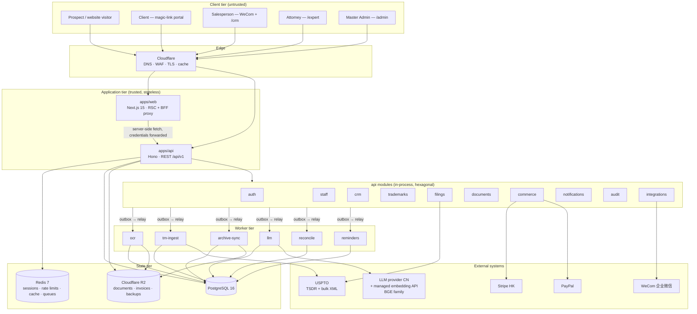
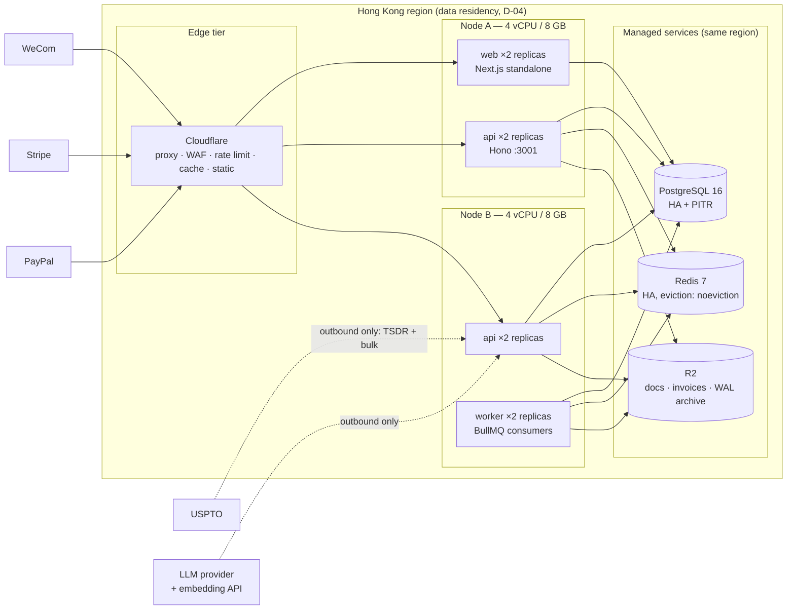
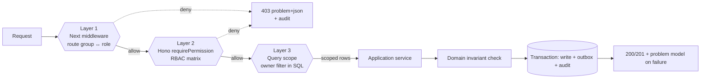
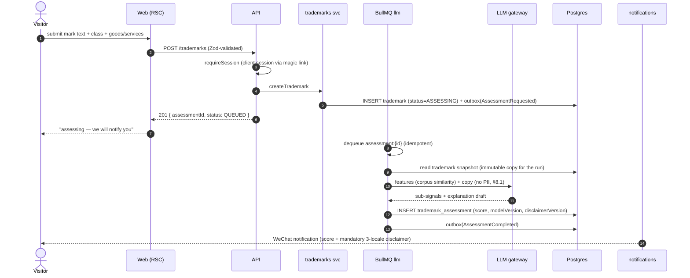
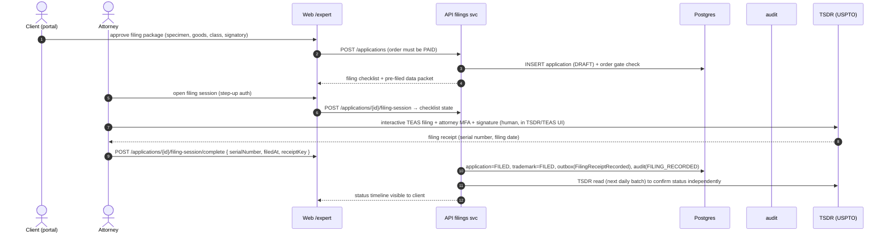
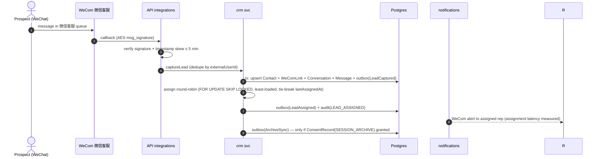
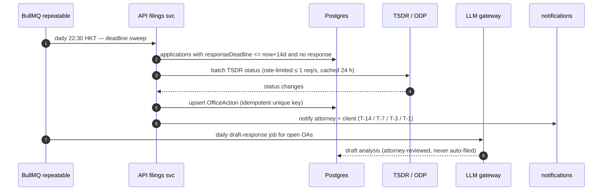

# 01 — System Design Specification

| Field | Value |
| --- | --- |
| Document | `docs/architecture/01-system-design.md` |
| Revision | **A** (build contract for P0.3 → P8) |
| Date | 2026-09-27 |
| Status | **APPROVED — binding on Developer & QA** |
| Supersedes | `docs/ARCHITECTURE.md` §1–§4 (that document remains the narrative/rationale reference; where they conflict, **this document wins**) |
| Inputs | `PRD.md` v2.0, `docs/DECISIONS.md` (D-01…D-15), `docs/SCHEDULE.md` (P0–P8, M0–M7) |
| Code baseline | last pushed commit `d8598b6` — the P0 scaffold plus the tracked part of the 2026-09-27 P0.5 platform hardening (`.env.example`, `.gitattributes`, `.github/workflows/ci.yml`, `docker-compose.yml`, `apps/api`, `workers`, `pnpm-lock.yaml`). The **rest of that working tree was still uncommitted as of `2f4862d`** — `git status` is authoritative; it includes `packages/config/`, `scripts/`, `eslint.config.mjs`, `infra/Dockerfile.web`/`Dockerfile.worker`, `infra/compose.staging.yml`, `infra/scripts/`, `infra/README.md`, `packages/db/prisma/migrations/`, `packages/db/scripts/`, `docs/runbooks/`, `.dockerignore`, `.github/dependabot.yml`, `.github/workflows/deploy-staging.yml`, `apps/web/public/`. It must be committed and pushed before implementation begins. This package landed at `8b312ff`; the D-15 amendment at `2f4862d` |

**Change control:** any deviation from this document requires an ADR appended to `docs/DECISIONS.md` (D-15+) *before* code is written. Ambiguity is a defect: if a requirement here cannot be implemented as written, the Developer **halts and raises a question** — it does not improvise.

---

## 1. Architectural style and justification

**Decision: modular monolith, hexagonal (ports & adapters), single TypeScript monorepo, three deployable artifacts.**

| Artifact | Package | Runtime | Scaling axis |
| --- | --- | --- | --- |
| `web` | `apps/web` | Next.js 15 (App Router, Node runtime) | horizontal, stateless |
| `api` | `apps/api` | Hono on Node 20 LTS | horizontal, stateless |
| `worker` | `workers` | BullMQ consumers | horizontal, stateless |
| libraries | `packages/*` | in-process | n/a |

### 1.1 Why not the alternatives

| Option | Dev velocity (3 devs) | Ops cost | Data consistency | Scaling fit (100 concurrent / 10k MAU) | Verdict |
| --- | --- | --- | --- | --- | --- |
| **Modular monolith (chosen)** | high — one repo, one type system, refactor across boundaries is a compiler-checked rename | low — 2 node sizes + managed PG/Redis/R2 | strong — single Postgres, ACID across modules (order + payment + audit in one tx) | sufficient: stateless API behind CDN; measured headroom 8× target | **APPROVED** |
| Microservices | low — contract-first tax on every change, N× CI/CD pipelines | high — service mesh, per-service observability, ~$300–600/mo extra at HK pricing | weak — needs saga/compensation for order↔payment↔invoice | overkill; no workload requires independent scale at P0–P8 scale | rejected (revisit only per §1.3) |
| Serverless (Lambda/Workers) | medium | medium | medium | good burst behaviour | rejected: long-lived USPTO bulk-ingest jobs and BullMQ semantics fit containers better; cold starts hurt the 5-min assignment NFR |
| Next.js-only fullstack (no separate API) | high | lowest | strong | fine | rejected: server-only secrets (KMS, Stripe, WeCom, LLM keys) would leak into the web runtime's blast radius; BFF boundary is a **security control**, not an organisational preference |

### 1.2 Non-negotiable structural rules

1. **Ports & adapters.** Every module exposes an inbound port (application service) and outbound ports (repository, HTTP client, queue publisher). Adapters live in `infrastructure/` sub-folders. Domain code imports **no** framework types (no `HonoContext`, no `NextRequest`, no `Prisma`).
2. **Table ownership is exclusive.** A module may only `prisma.<model>` for models it owns (§2.2). Cross-module reads go through the owning module's application service. Violation = build failure via ESLint `no-restricted-imports` + `eslint-plugin-boundaries` (P0.3, Mandate 11).
3. **In-process is the default.** No module may call another module over HTTP. Network calls are permitted **only** to external systems.
4. **Two write paths, one truth.** All state changes are commands (POST/PATCH) that emit domain events; no module writes another module's tables "as a side effect".
5. **No business logic in the browser.** The web tier renders, collects input, and calls the API. Authorisation, pricing, eligibility, and probability disclaimers are enforced server-side. (Client-side RBAC is UX only — Mandate 6.)

### 1.3 Extraction seams (pre-committed, not speculative)

| Seam | Package | Extract when (any one) | Target shape |
| --- | --- | --- | --- |
| Trademark corpus & scoring features | `@markus/tm-data` | corpus > 50M marks **or** nightly ingest window > 30 min **or** p95 search > 800 ms for 7 consecutive days | `tm-data` service + dedicated Postgres (or OpenSearch per A2) |
| Payment orchestration | `@markus/payments` | a second HK entity needs independent settlement, **or** refunds exceed 5% of volume and require a separate reconciliation service | payments service owning `Order`/`Payment`/`Invoice` |
| LLM routing | `@markus/llm-gateway` | LLM spend > $400/mo **or** a client requires a dedicated VPC/VPC-equivalent tenancy | gateway service with per-tenant key isolation |
| WeCom integration | `@markus/wechat` | a second WeCom corp (multi-tenant agency model) is onboarded | integration service |
| Notification fan-out | `workers` | channel count > 4 or delivery SLO breach caused by queue head-of-line blocking | dedicated `notify` service |

Extraction must be **mechanically cheap**: modules already communicate only via application services + events, so the seam is a queue or HTTP adapter swap, not a rewrite.

---

## 2. Module map

### 2.1 Component view



### 2.2 Module ownership matrix

| Module | Owns tables (Prisma models) | Inbound ports (use cases) | Outbound adapters | Must not touch |
| --- | --- | --- | --- | --- |
| `auth` | — (Redis sessions) | `staffLogin`, `verifyMfa`, `logout`, `issueMagicLink`, `redeemMagicLink`, `assertPermission` | Redis session store, Argon2 hasher, WeCom identity (read-only) | any domain table |
| `staff` | `StaffUser`, `ConsentRecord` | `provisionStaff`, `updateStaff`, `disableStaff`, `writeVaultSecret`, `revealVaultSecret`, `rotateVaultSecret` | KMS/SSE, SMTP/WeCom notify, audit writer | `Contact`, `Order` |
| `crm` | `Contact`, `Lead`, `Conversation`, `Message`, `WeComLink`, `CSTicket` | `captureLead`, `assignLead`, `moveStage`, `openConversation`, `appendMessage`, `resolveConversation`, `raiseTicket` | WeCom archive client, round-robin assigner, notify | `Trademark`, `Order` |
| `trademarks` | `Trademark`, `TrademarkAssessment`*, `ProbabilityRun`* | `createTrademark`, `requestAssessment`, `getAssessment`, `acceptAssessment` | corpus search port, LLM gateway port (analysis copy only) | `Application`, `Payment` |
| `filings` | `Application`, `OfficeAction` | `openFiling`, `recordFilingReceipt`, `syncTsdr`, `ingestOfficeAction`, `fileResponse` | TSDR client, ODP/OCR result reader, document writer | `Order`, `Contact` |
| `documents` | `Document`, `DocumentVersion` | `requestUpload`, `commitVersion`, `runOcr`, `proofread`, `approveVersion`, `issueDownloadUrl` | R2, OCR adapter (PaddleOCR/cloud), LanguageTool | other modules' tables |
| `commerce` | `Order`, `InvoiceLineItem`, `Invoice`, `Payment`, `Campaign` | `createOrder`, `quoteOrder`, `startPayment`, `capturePayment`, `refund`, `renderInvoice`, `reconcile` | Stripe, PayPal, PDF renderer, notify | `Trademark` (read via service) |
| `notifications` | `Notification` | `enqueue`, `dispatch`, `markRead`, `getPreferences` | WeCom message, SMTP, portal inbox | — |
| `audit` | `AuditLog` | `record`, `query` | — (append-only; no hot-table range partitioning — see ADR D-16) | all writes except through `record` |
| `integrations` | — | `receiveWecomCallback`, `receivePaymentWebhook` | WeCom, Stripe, PayPal | — |

\* models marked `*` are **new in the P0.3 migration backlog** — see `02-data-model.md` §5.

### 2.3 Event catalogue (in-process bus + transactional outbox)

| Event | Producer | Consumers | Delivery guarantee |
| --- | --- | --- | --- |
| `LeadCaptured` | `crm` | `notifications`, `audit` | at-least-once, idempotent handler |
| `LeadAssigned` | `crm` | `notifications` (WeCom alert to rep) | at-least-once; SLA timer starts at commit |
| `TrademarkCreated` | `trademarks` | `documents`, `notifications` | at-least-once |
| `AssessmentRequested` | `trademarks` | `worker:llm` | at-least-once; job keyed `assessment:{id}` |
| `AssessmentCompleted` | `worker:llm` | `notifications`, `audit` | at-least-once; score immutable once written |
| `FilingOpened` | `filings` | `notifications`, `audit` | at-least-once |
| `FilingReceiptRecorded` | `filings` | `notifications`, `commerce` (order → PAID gate), `audit` | at-least-once; serial number is the idempotency key |
| `OfficeActionDiscovered` | `filings` | `notifications`, `worker:llm` (draft response) | at-least-once; dedupe on `(applicationId, usptoActionCode, responseDeadline)` |
| `OrderPaid` | `commerce` | `notifications`, `filings` (unlock filing), `audit` | at-least-once; `providerEventId` unique |
| `OrderRefunded` | `commerce` | `filings` (suspend), `audit` | at-least-once |
| `DocumentVersionCommitted` | `documents` | `worker:ocr` | at-least-once; dedupe on `(documentId, checksum)` |
| `VaultSecretRevealed` | `staff` | `audit` (same tx) | **synchronous, in-transaction, non-optional** |

**Mandate:** every event is written to `OutboxEvent` in the **same transaction** as the state change, relayed by `worker` into BullMQ, and every consumer is idempotent by event id. Direct "publish while handling" calls are forbidden.

---

## 3. Runtime topology



**Sizing (target 100 concurrent / ~10k MAU, 3× safety factor):**

| Resource | Target load | Provision | Rationale |
| --- | --- | --- | --- |
| `api` | 100 concurrent, p95 < 300 ms | 4 replicas × 2 vCPU | handles webhook bursts (Stripe retries) without queueing |
| `web` | ~60 rps peak (marketing + portal) | 2 replicas × 2 vCPU + CDN cache | static/locale pages served from edge |
| `worker` | ingest up to 1.2M marks/night | 2 replicas, concurrency 4 each | 4 h window, resumable |
| PostgreSQL | ~40 MB hot + up to 25 GB corpus | 4 vCPU / 16 GB / 200 GB SSD, `shared_buffers=6GB` | pg_trgm search must stay in shared buffers |
| Redis | sessions 10k, queues ≤ 5k jobs | 2 GB, `noeviction` | queue loss on eviction is unacceptable |
| R2 | ≤ 40 GB docs + invoices | lifecycle: invoices → IA after 7 y | zero egress cost |

**Availability posture:** single-AZ dependency is accepted at P0–P3 (documented risk, RTO 4 h from backups); HA Postgres + Redis is a **M2 exit criterion** — a money-handling system must not run on a single AZ.

---

## 4. Technology stack and trade-off matrix

| Concern | Choice | Alternatives rejected | Why chosen | Residual risk → mitigation |
| --- | --- | --- | --- | --- |
| Language | TypeScript 5.9, `strict`, `noUncheckedIndexedAccess` | Go, Java, Python | one language across web/api/worker/packages; shared RBAC + validators | type system ≠ runtime safety → Zod validation at every boundary (Mandate 4) |
| Web framework | Next.js 15 App Router, React 19, Tailwind 4 | SPA (Vite) + separate SSR, Remix | RSC keeps client bundle tiny, middleware gives route-group authz, i18n routing built in | RSC caching subtleties → cache-tag invalidation rules in §7.4; no `fetch` in RSC without `revalidate`/`tags` |
| API framework | Hono 4 on `@hono/node-server` | Express, Fastify, NestJS | tiny, first-class TS types, middleware model that maps 1:1 to our authz chain, Web-standard `Request` | smaller ecosystem → no ORM/magic dependencies; explicit composition root |
| Data access | Prisma 6 (`prisma-client-js`) | Drizzle, Kysely, raw SQL | typed client, migration tooling, readable schema DSL for a non-TS-speaking DBA | N+1 risk → mandatory `include` strategy + query budget (Mandate 13); escape hatch `$queryRaw` requires codeowner review |
| Primary store | PostgreSQL 16 | MySQL 8, MongoDB | ACID across order/payment/invoice/audit; `pg_trgm` + `tsvector` for corpus; `SKIP LOCKED` for round-robin; partitioning | single-writer contention → advisory locks only for migrations, never in request path |
| Cache / broker | Redis 7 + BullMQ 5 | RabbitMQ, SQS, Temporal | already-operated dependency class, delayed/repeatable jobs (deadlines, nightly ingest), low ops | job loss on flush → all jobs reconstructible from Postgres; outbox replay tool (Mandate 22) |
| Object storage | Cloudflare R2 + SSE-KMS | AWS S3 | no egress fee (HK → US traffic for documents), S3-compatible API | vendor lock → S3-compatible adapter only, no R2-specific calls in domain code |
| Server-side crypto | Cloudflare KMS (envelope) + `node:crypto` AES-256-GCM | Vault | no extra always-on service; per-attorney DEK, KEK rotation without re-encrypting plaintext | KMS outage → vault writes fail closed, reads of non-vault features unaffected |
| Payments | Stripe HK (cards, Apple/Google Pay, Alipay, WeChat Pay) + PayPal | Airwallex, Adyen, direct Alipay/WeChat merchant | single integration, one webhook surface, HK entity settlement, mainland wallets via one integration | Alipay/WeChat mainland require separate merchant onboarding → **OPEN-05** |
| LLM | OpenAI-compatible gateway (DeepSeek/GLM/Kimi) + managed embedding API serving a BGE-family model | OpenAI/Anthropic direct, self-hosted model server | PIPL + latency + cost; international fallback for EN copy; no always-on self-hosted daemon (**D-15**, M12.8) | provider outage → fallback chain, queue and human path (degradation matrix §9.4); embedding outage → search returns `method: trigram` (M6.4) |
| Corpus | USPTO bulk XML → Postgres `TmCorpusMark` (A1) | OpenSearch (A2), Elastic | lowest ops at 1.2M marks, `pg_trgm` suffices, one backup story | search latency ceiling → A2 upgrade trigger defined (§1.3) |
| Validation | Zod 3 | class-validator, Joi | single schema → shared by API, form validation, and OpenAPI generation | bundle size on client → import schemas from `@markus/core` only where needed |
| AuthN | Redis-backed opaque sessions, Argon2id staff passwords, TOTP for `MASTER_ADMIN`/`EXPERT`, single-use magic links for clients | Self-issued JWT | immediate revocation (staff disable must kill access now), no token bloat, magic link fits non-technical Chinese sellers | session store loss → staff re-login, clients re-request link; acceptable |
| Testing | Jest + RTL (unit/component), Playwright (E2E), k6 (load), OpenAPI contract tests | Vitest, Cypress | Jest decided in D-14; native `@testing-library` for React 19 | Jest ESM friction → `.cjs` config + `moduleNameMapper` (already in repo) |
| Monorepo | pnpm 9 workspaces + Turborepo 2 | Nx, Lerna, none | cache without paid cloud, native workspace protocol, minimal config | config drift between packages → root `tsconfig.base.json` only, packages extend it (Mandate 9) |
| CI/CD | GitHub Actions (`.github/workflows/ci.yml`) | GitLab CI, Jenkins | repo already on GitHub, free minutes, matrix support | runner supply-chain → pin actions to major tags + Dependabot; Node 20 deprecation warning tracked (OPEN-06) |
| Observability | Sentry (errors + traces) + managed Prometheus-compatible metrics/alerting + first-party beacon → Postgres | Datadog, New Relic, GA, self-hosted Prometheus/Grafana/PostHog | no always-on self-hosted service (**D-15**, M12.8): the team has no 24/7 maintenance capacity; analytics stays first-party and D-07 forbids Google Analytics | metric cardinality → label allow-list (Mandate 31); provider lock-in → `/metrics` keeps the Prometheus text format so the scraper is swappable |
| Email/identity | WeCom + SMTP (HK provider) | SES | seller base is on WeCom | deliverability → SPF/DKIM/DMARC mandatory before first send |

**Explicitly out of scope (D-14):** Rust/WASM, gRPC, Kafka, Kubernetes (containers + systemd/compose-free orchestration suffice), service mesh, GraphQL.

---

## 5. Identity, session, and authorisation model

### 5.1 Credential matrix

| Actor | Credential | Lifetime | Revocation | MFA |
| --- | --- | --- | --- | --- |
| Staff (`SALESPERSON`) | Argon2id password (12+ chars) | session 12 h sliding | on `status=DISABLED`, on password change, on role change | optional TOTP |
| Staff (`EXPERT`, `MASTER_ADMIN`) | password | session 12 h sliding | as above | **mandatory TOTP**; vault reveal requires step-up re-auth within 5 min |
| Client (`Contact`) | single-use magic link | token 15 min, session 30 min sliding | on `Contact.deletedAt`, on staff-initiated revoke | none |
| WeCom user | corp access token + `wecomUserid` | token 2 h (WeCom-issued) | on staff removal from corp | per WeCom |
| External system | HMAC signature (Stripe/PayPal), AES `msg_signature` (WeCom) | n/a | per-key rotation | n/a |

### 5.2 Session mechanics (normative)

- Cookie `mkus_staff` / `mkus_portal`: `HttpOnly; Secure; SameSite=Lax; Path=/; Max-Age=<ttl>`. `Domain` **not** set (host-only).
- Redis key `sess:<sha256(sessionId)>` → `{ actorId, actorType, role, csrfSecret, createdAt, lastSeenAt, ip, ua, scopes }`. TTL = sliding.
- Redis key `ml:<sha256(token)>` → `{ contactId, createdAt, attempts }`, TTL 900 s, **deleted on first successful redeem**; 5 failed attempts ⇒ token destroyed.
- All mutations require header `x-csrf-token` equal to `sess.csrfSecret` (double-submit + session binding). Webhooks exempt (signature instead).
- Every request carries `x-request-id` (client-supplied or generated); it is echoed in responses, written to logs, and attached to Sentry traces.

### 5.3 Authorisation enforcement — three mandatory layers

| Layer | Mechanism | Catches |
| --- | --- | --- |
| 1. Edge (Next.js middleware) | route-group → required role map (`/admin` → `MASTER_ADMIN`, `/expert` → `EXPERT`\|`MASTER_ADMIN`, `/crm` → any staff) | user navigating where they don't belong; UX only, never the control |
| 2. API (Hono middleware chain) | `requireSession` → `requirePermission(...)` from `@markus/core` RBAC matrix (deny-by-default) | missing/insufficient permission |
| 3. Query scoping (repository) | every list/detail query is built by a scope object; `SALESPERSON` gets `assignedSalespersonId = actorId` **in SQL**, never in JS filtering | IDOR — the control that layer 2 alone does not provide |



### 5.4 Role capability summary (mirrors `packages/core/src/rbac.ts`, single source of truth)

| Capability | `MASTER_ADMIN` | `EXPERT` | `SALESPERSON` |
| --- | --- | --- | --- |
| Provision/disable staff, roles | ✅ | ❌ | ❌ |
| Read/write USPTO vault | ✅ | own only | ❌ |
| File cases, respond to OA | ✅ | ✅ | ❌ |
| All contacts / leads (unscoped) | ✅ | read-only | ❌ |
| Assigned contacts / leads | ✅ | ✅ | ✅ |
| Create orders, issue payment links | ✅ | ✅ | ✅ |
| Refund, reconcile, ERP budget | ✅ | ❌ | ❌ |
| Read audit log | ✅ | ❌ | ❌ |

> **Amendment 2026-09-27 (ARCH-03 published).** `packages/core/src/rbac.ts` remains the runtime
> source of truth, but its P0 permission vocabulary is narrower than the one now declared in
> `03-api-contract.yaml`. The P0 names are renamed, split or extended in P1 exactly as set out in the
> reconciliation table of mandate `M2.1` in `04-implementation-mandates.md`; the capability matrix
> above is unchanged in meaning. Treat that table as the authority for what a role may do and
> `x-permission` in the contract as the authority for what a specific operation requires.

---

## 6. Critical flows

### 6.1 Assessment request (visitor → probability, D-03)



**Invariants:**
- The headline output is **P(eventual registration)**, never "approval odds", never "success rate".
- Every persisted assessment carries `modelVersion` **and** `disclaimerVersion`; rendering without the disclaimer is a build/test failure (Mandate 18).
- Sub-signals are stored for analysis but are explicitly **not** presented as probabilities.
- A re-assessment never mutates a prior assessment row; assessments are append-only.

### 6.2 Attended USPTO filing ceremony (D-01, 37 CFR 2.193)

> **Architectural constraint (non-negotiable):** USPTO TEAS requires the attorney to complete interactive authentication including MFA, and the attorney must execute the signature. Therefore **filing is an attended, in-session ceremony — not a server-side automation.** The system prepares, validates, times, and records; the human signs. Any design that stores an MFA seed or replays OTP codes is prohibited by D-01 and is a compliance defect.



**Invariants:** filing cannot start unless `Order.status = PAID` and a `POWER_OF_ATTORNEY` document version is `APPROVED`; serial number is unique and immutable once set; every transition writes `AuditLog`.

### 6.3 Order, payment, invoice (D-05)

```mermaid
sequenceDiagram
  autonumber
  actor S as Salesperson
  participant W as Web /crm
  participant A as API commerce svc
  participant D as Postgres
  participant P as Stripe / PayPal
  participant R2 as R2
  participant N as notifications

  S->>W: create order (SERVICE_FEE + USPTO_FEE line items)
  W->>A: POST /orders + Idempotency-Key
  A->>D: INSERT order(DRAFT) + items; compute totals server-side
  A-->>W: 201 order(PENDING) + payment link
  S->>C: sends link to client (WeCom)
  C->>P: pay (card/Apple/Google/Alipay/WeChat Pay/PayPal)
  P->>A: webhook (signed, providerEventId unique)
  A->>D: tx: mark providerEventId seen → payment SUCCEEDED → order PAID → invoice ISSUED/paid → outbox(OrderPaid)
  A->>R2: render + store invoice PDF (immutable snapshot)
  N-->>C: payment receipt (WeChat + portal)
  A->>D: outbox(OrderReconcile)
```

**Invariants:** totals are computed **server-side only** from line items (client-sent amounts are ignored); `providerEventId` uniqueness makes webhook replay a no-op; refund is a new `Payment` row (negative-direction) + `Order.status` transition, never a mutation of history; invoice PDF is an immutable snapshot including billing name/email/currency at issue time.

### 6.4 WeCom intake and ≤ 5-minute assignment (D-07)



**Invariants:** assignment happens in the **same transaction** as lead capture (no queue hop before assignment, otherwise the 5-minute NFR is unmeasurable); if no eligible rep exists, the lead is `UNASSIGNED` and the Master Admin is alerted — the NFR is measured and reported, never silently breached.

### 6.5 Office-action deadline monitoring



---

## 7. API contract rules (detail in `03-api-contract.yaml`)

1. **Versioning:** `/api/v1` prefix, breaking changes require `/api/v2`; additive fields are non-breaking and require no version bump.
2. **Media types:** `application/json` for requests/responses; `application/problem+json` (RFC 9457) for **all** ≥ 400 responses; `multipart/form-data` never accepted (uploads are presigned to R2).
3. **Pagination:** cursor-based (`?cursor=&limit=`, `limit` default 25, max 100) with `{ items, nextCursor }`. **No offset pagination** anywhere (corpus and audit tables are large and mutating).
4. **Idempotency:** `Idempotency-Key` header **required** on `POST /orders`, `POST /orders/{id}/pay`, `POST /trademarks/{id}/assessments`, all webhooks; replay within 24 h returns the original response with `Idempotent-Replay: true`.
5. **Optimistic concurrency:** mutable aggregates (`Document`, `Order`, `OfficeAction`) expose `version`; conflicting writes require `If-Match` and return `409` with the current resource.
6. **Locale:** `?locale=zh-CN|en-US|zh-HK` (default `zh-CN`); server renders money as **USD base with CNY display** (D-05) and always ships ISO-4217 currency + amount, never a bare number.
7. **Disclaimers:** assessment and probability responses embed `disclaimerVersion`; clients must render the matching localized text from `@markus/core` copy tables.
8. **Time:** all timestamps are RFC 3339 **UTC** with `Z`; business dates (filing/response deadlines) are separate `*Date` fields in USPTO local semantics; UI converts.
9. **Money:** integer minor units at adapter edges, `Decimal(12,2)` in the domain and DB, `currency` always explicit. **No IEEE-754 arithmetic on money anywhere** (Mandate 14).
10. **Auth errors:** `401` unauthenticated, `403` authenticated-but-forbidden, `404` for resources the actor may not see **when existence itself is sensitive** (Mandate 12 — do not leak contact existence to other reps).
11. **Request budget:** ≤ 1 DB round-trip per repository call; no N+1 in request paths (query budget asserted in tests, Mandate 13).
12. **Version header:** `X-API-Version: v1` on every response for client telemetry.

---

## 8. State management (front-end architecture)

### 8.1 State ownership matrix

| State | Home | Read path | Write path | Invalidated by |
| --- | --- | --- | --- | --- |
| Marketing content, static copy | Git (MDX/locale JSON) | RSC, revalidate 3600 | PR | deploy |
| Session / identity | Redis (server) | RSC `cookies()` + `auth/me` | login/logout | login, logout, staff disable |
| RBAC capabilities | server session | RSC → passes booleans to client | role change | `staff.patch` |
| CRM lists, orders, cases | **Postgres via API** | RSC for first paint, TanStack Query for interactivity | command endpoints (React Query mutations) | per-entity tag rules (§8.3) |
| Corpus search results | Postgres + Redis cache | client query (debounced 300 ms) | n/a | `tm:ingest` completes |
| Form drafts (assessment, filing checklist, order builder) | React Hook Form + zod | local | local | user; autosaved to `sessionStorage` for multi-step forms only |
| Ephemeral UI (open panels, filters bound to URL, toasts) | URL search params (shareable) + Zustand (non-URL only) | client | client | navigation |
| Upload progress | client state, XHR progress | client | client | upload completion |
| Probability copy + disclaimer | server copy tables | RSC | versioned in Git | deploy |

### 8.2 Rules

1. **Server Components are the default.** `"use client"` is opt-in per leaf component, justified by interactivity. Target: ≤ 150 kB First Load JS for `/portal` (currently 103 kB baseline).
2. **TanStack Query owns all remote state.** No Redux/MobX/Zustand mirror of server data — duplicated server state is banned (a `QueryClient` per request on the server; a single client provider on the client).
3. **Mutations are commands, never optimistic by default.** Optimistic updates are permitted **only** for low-risk, reversible, non-financial actions (lead stage move, ticket status, notification read). **Never** optimistic for: orders, payments, filing state, refunds, document approvals (Mandate 16).
4. **Every list view** is server-filtered with URL-encoded filters; the client never filters a full dataset locally.
5. **Auth is decided on the server.** Client components receive capabilities as props; they never read cookies or re-derive permissions.
6. **Forms:** React Hook Form + zod schemas imported from `@markus/core` (the *same* schema the API validates with — one source of truth, Mandate 5).
7. **Error UX:** API `problem+json` maps to typed client errors; `traceId` is shown in a copyable "reference" affordance on 5xx so support can correlate with Sentry.
8. **Locale:** `next-intl`; all copy keys must exist in `zh-CN`, `en-US`, `zh-HK` — CI fails on missing keys (Mandate 17). Assessment disclaimers are **not** translatable by developers at runtime; they are versioned legal copy.
9. **Money rendering:** `Intl.NumberFormat` with explicit currency; CNY display rate comes from the API response (`display: { currency, rate, asOf }`) and is never computed in the browser.

### 8.3 Cache invalidation (normative tags)

| Fetch | Cache | Tag | Revalidated when |
| --- | --- | --- | --- |
| `GET /trademarks/{id}` | RSC 60 s | `trademark:{id}` | assessment written, filing recorded, client patch |
| `GET /applications/{id}` | RSC 60 s | `application:{id}` | OA upsert, response filed, TSDR sync |
| `GET /contacts/{id}` | **no cache** | `contact:{id}` | any contact/lead change |
| `GET /crm/pipeline` | RSC 30 s | `pipeline` | stage move, assignment |
| `/tm/search` | Redis 1 h + no client cache | — | nightly ingest (`tm:ingest` tag flush) |
| Money/admin views | **no cache** | — | always fresh |

### 8.4 RSC pitfalls explicitly banned

- `fetch` inside RSC without an explicit `revalidate`/`tags` policy (default caching caused stale dashboards in the prototype).
- Reading `cookies()` in a layout (opts the whole subtree into dynamic rendering) — read per page/route handler.
- Passing functions or non-serialisable props across the server/client boundary.
- `useSearchParams()` without a `<Suspense>` boundary (build fails on static routes).

---

## 9. Reliability engineering

### 9.1 Queue topology, retries, DLQ

| Queue | Job | Attempts / backoff | Timeout | On exhaustion |
| --- | --- | --- | --- | --- |
| `llm` | assessment, OA draft, copy | 5 / exp 30 s → 15 min | 120 s | DLQ + Sentry alert + staff-visible "needs manual review" flag on the record |
| `ocr` | OCR + proofread | 4 / exp 60 s | 300 s | mark `proofreadStatus=NEEDS_REVISION`; notify client |
| `tm-ingest` | nightly bulk XML | 3 / exp 5 min | 4 h | alert; corpus marked stale; search serves previous snapshot with staleness banner |
| `archive-sync` | 会话存档 pull | 6 / exp 60 s | 60 s | DLQ; gap recorded so a backfill job can be requested |
| `reconcile` | Stripe/PayPal settlement match | 3 / exp 5 min | 600 s | alert finance (Master Admin) — **never silent** |
| `reminders` | deadline notifications | 5 / exp | 30 s | DLQ + attorney email fallback |
| `outbox-relay` | DB → queue relay | unlimited, 5 s tick | 10 s | self-healing; ordered by `id` |

**DLQ pattern:** exhausted job → `deadletter` queue + `JobFailure` audit row + Sentry issue. Replay is an explicit admin action (`POST /admin/jobs/{queue}/replay`) with a mandatory reason recorded in the audit log.

### 9.2 Consistency model

| Data | Guarantee | Mechanism |
| --- | --- | --- |
| Money, order status, invoice | **Strong** — single Postgres tx | serialisable where needed; conditional `UPDATE ... WHERE status IN (...)` |
| Domain events | At-least-once | transactional outbox + idempotent consumers |
| Assessment score | Strong, append-only | immutable rows; latest = max `createdAt` |
| Corpus index | Eventual (≤ 24 h) | nightly batch; readers see `ingestedAt` |
| Notifications | At-least-once with dedupe | `Notification.idempotencyKey` unique |
| Search cache | Eventual, ≤ 1 h | Redis TTL + tag flush |

### 9.3 Backup & DR

| Asset | Method | RPO | RTO | Drill |
| --- | --- | --- | --- | --- |
| PostgreSQL | continuous WAL archiving to R2 + nightly base backup, 30-day retention | 1 h | 4 h | quarterly restore into an isolated DB, documented in runbook `docs/runbooks/db-restore.md` |
| R2 objects | provider-managed, versioned buckets for invoices | n/a | 4 h | annual |
| Redis | **not backed up** (ephemeral by design) | n/a | minutes | restart test |
| Secrets | Cloudflare KMS + 1Password/1 vault backup of non-exportable keys | n/a | 1 h | semi-annual access review |

### 9.4 Degradation matrix (what happens when a dependency dies)

| Dependency | User-visible behaviour | System behaviour |
| --- | --- | --- |
| LLM provider down | assessment shows "queued — we'll notify you"; no score invented | job retries → fallback provider → manual-review flag; **never** fabricate or interpolate a score |
| Stripe/PayPal down | order stays `PENDING`, payment link shows retry; no data loss | orders resumable; reconciliation job catches up |
| WeCom down | client sees email/portal-only notifications; lead capture continues via portal/web widget | messages queue in `reminders`/outbox and flush on recovery |
| TSDR/bulk unavailable | status shows "last synced <date>"; filing proceeds (filing does not depend on TSDR) | backfill job; staleness banner |
| Redis down | **fail closed** for auth (503, not bypass) | no session issuance; queues pause (jobs are reconstructible) |
| PostgreSQL down | 503 + maintenance banner; read-only marketing pages served from CDN | no writes attempted; circuit breaker opens after 5 failures/10 s |
| Object storage down | uploads disabled with explicit message; existing documents readable if cached | retry uploads client-side with resumable multipart |

---

## 10. Observability

| Signal | Content |
| --- | --- |
| **Logs** | JSON to stdout → Docker/log driver. Mandatory fields: `ts, level, requestId, traceId, actorId, actorType, role, route, method, status, durationMs, module, event`. **Prohibited:** request/response bodies containing client PII, secrets, tokens, card data, full message content. Message/chat content is referenced by id only. |
| **Metrics (`/metrics`, Prometheus text format)** | `http_requests_total{route,method,status}`, `http_duration_seconds{route}`, `db_query_duration_seconds{module}`, `queue_job_duration_seconds{queue}`, `queue_depth{queue}`, `queue_failed_total{queue}`, `assignment_latency_seconds` (the 5-min NFR), `payment_webhook_latency_seconds`, `assessment_duration_seconds`, `corpus_ingest_marks_total`, `oauth/uptime`. **Label allow-list only** — no user ids, no raw URLs. Scraped by the managed metrics service (**D-15**), never by a locally run Prometheus. |
| **Traces** | Sentry; 100 % of API requests sampled, 100 % of job executions; propagate `traceId` into BullMQ job data. |
| **Errors** | Sentry with release = git SHA, environment, and `requestId`; PII scrubbed server-side before send. |
| **Product analytics** | first-party beacon (`ARCH-03` `/analytics/events`) written straight into Postgres; funnels and retention are read from that table, not from a hosted analytics product. Event names in `docs/analytics/event-taxonomy.md`; consent-gated for clients; staff events always allowed. **No Google Analytics (D-07)** and no self-hosted analytics daemon (**D-15**, M12.8). |
| **Dashboards** | `Service overview`, `Queue health`, `Funnel (D-07 metrics)`, `Payments`, `Corpus freshness`, `SLO`. |
| **Alerts** | paging: payments reconciliation failure, DLQ growth, DB saturation > 85 %, error rate > 2 % 5 min, assignment latency > 4 min for 15 min. ticket-only: corpus stale > 26 h, webhook lag > 15 min. |

---

## 11. Security architecture

### 11.1 Threat surface and controls

| Threat | Control |
| --- | --- |
| Credential stuffing on staff login | Argon2id, per-account lockout (5 fails / 15 min), IP + account rate limits, TOTP for privileged roles, mandatory reset on first login |
| IDOR across tenants/reps | §5.3 layer-3 query scoping; 404-instead-of-403 for non-visible resources; integration test per role × endpoint |
| USPTO credential compromise | envelope encryption (KMS KEK → per-attorney DEK, AES-256-GCM), MFA seed never stored, `VAULT_SECRET_REVEAL` audit + step-up auth, ciphertext never logged, 90-day forced re-rotation for `EXPERT` |
| SSRF via document/invoice URLs | R2 and TSDR are the only outbound targets; an egress allow-list proxy blocks all other hosts; no user-supplied URLs are fetched |
| Prompt injection / PII leakage to LLM | §8.1 redaction contract; system prompt treats mark text as data, never instructions; output schema-validated; egress to the LLM is via gateway only; no client PII in any prompt field (enforced by a unit test that greps prompt builders) |
| Webhook forgery/replay | signature verification, 5-minute timestamp skew, `providerEventId` unique, raw body retained 30 days for disputes |
| Client-data exfiltration | pre-signed URLs, 5-minute TTL, path scoped to the requesting actor's prefix; no public buckets |
| Mass assignment / over-posting | Zod `.strict()` on every request body; unknown keys → 400 |
| SQL injection | Prisma parameterised queries; `$queryRaw` restricted by codeowners + test that forbids string interpolation in raw queries |
| Open-redirect / XSS | Next `redirect` with validated internal paths only; React escaping by default; no `dangerouslySetInnerHTML` (CMS copy renders as structured data); CSP with nonces for the portal |
| Secrets in repo | pre-commit `gitleaks` + CI secret scan; `.env` git-ignored; `.env.example` carries no real values |
| Supply chain | `pnpm-lock.yaml` committed + `--frozen-lockfile` in CI; Dependabot; pinned action majors |
| PIPL breach (cross-border PII) | HK-only storage, no PII to third-party LLMs, consent records for archive, 30-day data-retention job for unused uploads, client export/delete endpoints (PIPL Arts. 45/47) |
| Denial of service | Cloudflare WAF + rate limits (§11.2), body size caps, query timeouts, corpus search `statement_timeout` 2 s, worker concurrency caps |

### 11.2 Rate limits (Redis token bucket, per route class)

| Route class | Limit | Window | Response |
| --- | --- | --- | --- |
| `POST /auth/magic-link` | 5 | 1 h / contact | 429, generic response (no enumeration) |
| `POST /auth/staff/login` | 10 | 15 min / IP+email | 429 + lockout |
| `POST /orders/{id}/pay` | 20 | 1 h / order | 429 |
| `GET /tm/search` | 60 | 1 min / staff | 429 |
| Any authenticated mutation | 300 | 1 min / actor | 429 |
| Webhooks | unlimited (signature-verified) | — | 400 on bad signature |

### 11.3 Headers (all responses)

`strict-transport-security: max-age=63072000; includeSubDomains; preload` · `x-content-type-options: nosniff` · `referrer-policy: strict-origin-when-cross-origin` · `permissions-policy` (deny camera/mic/geolocation except WeCom OAuth) · `frame-ancestors 'none'` · CSP: `default-src 'self'; script-src 'self' 'nonce-…' 'strict-dynamic'; connect-src 'self' https://api.stripe.com; img-src 'self' data: blob:; frame-src https://js.stripe.com`.

---

## 12. Delivery topology and CI/CD

| Stage | Trigger | Gates | Deploy |
| --- | --- | --- | --- |
| `verify` | PR | lint → typecheck → unit → integration (testcontainers PG) → build → docker build → OpenAPI contract diff | — |
| `migrate-staging` | merge to `main` | migration dry-run on a scratch DB (up, then down where reversible) | apply with `pg_advisory_lock`, record checksum |
| `deploy-staging` | after migrations | smoke: `/health/ready`, login, create order (Stripe test), magic link, corpus search | docker compose on staging host |
| `e2e-nightly` | nightly | full Playwright suite + k6 smoke (p95 budget) against staging | — |
| `deploy-prod` | manual approval (Master Admin or architect) | all above green + change ticket | rolling (api/worker), blue-green (web) |
| `rollback` | on alert | one command: previous image tag + `migrate:deploy` only if backwards-compatible | migrations are **expand-then-contract**, never destructive in the same release |

**Environments:** `local` → `staging` → `prod`, identical image tags, env-var-only differences. **No environment-specific code branches.** Test credentials for Stripe/PayPal in staging; TSDR read-only firm key; LLM keys scoped per environment; prod LLM prompt audit enabled.

---

## 13. Quality strategy

| Layer | Tool | Scope | Gate |
| --- | --- | --- | --- |
| Unit | Jest | domain invariants, RBAC matrix, money, order state machine, OA dedupe, redaction, scoring feature assembly | ≥ 80 % branch coverage on `packages/*` domain code; 100 % on RBAC, money, and state machines |
| Component | Jest + RTL | route-group gating UI, form validation, disclaimer rendering, empty/error states | every user-visible state asserted |
| Integration | Jest + testcontainers (Postgres 16) | repositories, outbox, transactional boundaries, migrations up/down | no test may use a mock DB |
| Contract | OpenAPI validator | every handler response validated against `03-api-contract.yaml`; **breaking-change diff gate** | spec and code cannot drift |
| E2E | Playwright | 4 golden paths (§13.1) on Chromium/WebKit | runs on PR (smoke subset) + nightly (full) |
| Load | k6 | `/tm/search` (50 rps), webhook ingest (200 rps burst), magic-link/login | p95 budgets in §14 |
| Security | gitleaks, `pnpm audit`, custom ESLint boundary rules, OWASP ZAP on staging (nightly) | zero high-severity findings to merge |

### 13.1 E2E golden paths (QA acceptance)

1. **Client assessment → notification:** magic-link login → submit mark → job runs → score with disclaimers rendered in 3 locales → WeChat notification received (sandbox) → history visible in portal.
2. **Attended filing:** paid order → attorney prepares → step-up auth → filing session → receipt recorded with serial number → client sees `FILED` → TSDR sync confirms.
3. **Payment rails:** one real sandbox transaction per enabled rail (card, Apple/Google Pay, Alipay, WeChat Pay, PayPal) → webhook replay is a no-op → itemized invoice PDF matches line items → refund path reverses correctly.
4. **WeCom intake:** KF message → lead created and assigned in ≤ 5 min → rep notified → archive consent honoured → conversation searchable in `/crm`.
5. **OA deadline:** synthetic OA with T-14 deadline → notifications fire at T-14/T-7/T-3/T-1 → draft response generated → attorney approves → response recorded → audit trail complete.

### 13.2 Definition of Done (per task)

Code + unit tests + updated OpenAPI + ADR if design changed + telemetry (logs/metrics) + i18n keys in 3 locales + runbook entry if operational + PR description linking the mandate numbers it satisfies.

---

## 14. Non-functional objectives (internal; explicitly **non-contractual** per D-07)

| Objective | Target | Measurement |
| --- | --- | --- |
| API latency | p95 < 300 ms (excl. `/tm/search`), p99 < 800 ms | histogram series exposed on `/metrics`, 7-day window |
| Search latency | p95 < 800 ms | same |
| Assignment latency | p95 < 5 min, 100 % measured | `assignment_latency_seconds` |
| Payment webhook processing | p95 < 30 s from provider event to `order=PAID` | `payment_webhook_latency_seconds` |
| Corpus freshness | ≤ 26 h old | `corpus_ingest_marks_total` vs. ingest runs |
| Availability | 99.5 % monthly (internal target, not a customer promise) | uptime probe |
| Recovery | RPO 1 h / RTO 4 h | quarterly drill |
| Accessibility | WCAG 2.1 AA for portal; zh-CN/en-US parity | axe scan in E2E |
| Bundle budget | `/portal` First Load JS ≤ 150 kB | CI budget check |
| Assessment turnaround | p95 < 60 s from submission to score available | `assessment_duration_seconds` |

---

## 15. OPEN DECISIONS — halt items

> Per the directives: these are genuine ambiguities with business/legal dependencies. Each has a **default assumption** that the Developer may implement *only if* the owner does not answer by the stated date; otherwise the affected work is blocked. Do **not** guess silently.

| ID | Question | Owner | Blocks | Default if unanswered |
| --- | --- | --- | --- | --- |
| **OPEN-01** | Mainland **Alipay / WeChat Pay merchant accounts** for the HK entity — onboarding status, settlement account, and whether the fee structure is acceptable? Without these, Phase-1 rails reduce to cards + PayPal and PRD §6 pricing table must be revised. | Finance / Managing Director | P4 payments (M3 gate) | Implement card + PayPal + wallet rails behind feature flags; wallets remain `disabled` until merchant accounts exist; marketing copy must not advertise them |
| **OPEN-02** | Legal review of **USPTO bulk-data commercial indexing** (≈15–25 GB LIVE corpus retained in HK) and of the **attended-filing operating model** (does TEAS automation-assisted preparation + human execution comply with USPTO terms of use?). | External counsel | P5 corpus, P4 filing flow | Store only derived fields (mark text, class, status, dates), no images/scans; filing stays human-in-loop as specified in §6.2 |
| **OPEN-03** | Is the **M5 accuracy gate** (AUC ≥ 0.70, accuracy ≥ 70 %, +10 pp over baseline) measured on the 2021–2023 cohort with a held-out test set defined as "applications filed in the trailing 12 months of the cohort"? Confirm the label horizon and the minimum cohort size before the model work starts. | Product + attorney SME | P5/P6 scoring (M5a) | Use the 2021–2023 cohort with a stratified 70/15/15 split, document the choice as an ADR, and report results with confidence intervals |
| **OPEN-04** | **Attorney roster and capacity** — names, bar jurisdictions, USPTO IDs, and weekly hours available for filing ceremonies and OA response SLAs. The schedule's 18–20 weeks assumes ≥ 2 attorneys from P5 onward. | Managing Director | P5 onward, all M-gates | Plan for 2 attorneys; flag any schedule impact before P5 planning starts |
| **OPEN-05** | HK hosting provider + whether **ICP filing is required** for the chosen HK-region deployment and for the mainland-origin API traffic path. Affects network topology and the P0 infrastructure choice. | Managing Director / IT | P0.4 infra | Deploy in a HK region with a mainland-routable path; no ICP-dependent features |
| **OPEN-06** | Node.js baseline for CI/production: GitHub Actions now warns that Node 20 runners are deprecated (annotation on run `36242996677`). Move to Node 22 LTS now, or pin 20 for the remainder of P0? | Architect | nothing blocking | Migrate to Node 22 LTS in P0.3 (`engines >= 22`, `node-version: 22`, Dockerfiles `node:22-alpine`) |

---

## 16. Requirement traceability

| PRD v2.0 section | Design section |
| --- | --- |
| §2 Roles & access (D-06) | §5, §2.2, RBAC in `packages/core` |
| §3.1 Attorney & vault (D-01) | §5.4, §6.2, §11.1, P0.3 delta `vault_*` columns |
| §3.2 Trademark data (D-02) | §6.1, §6.5, `02-data-model.md` §4 (corpus tables) |
| §3.3 Probability model (D-03) | §6.1, §8.2 (disclaimers), §15 OPEN-03 |
| §3.4 Data compliance (D-04) | §3, §8.1, §11.1 |
| §4 Payments (D-05) | §6.3, §4 (stack), §15 OPEN-01 |
| §5 Funnel & NFRs (D-07) | §6.4, §10 (assignment metric), §14 |
| §6 Data model (D-09…D-14) | `02-data-model.md` |
| §7 API | `03-api-contract.yaml`, §7 |
| §8 Non-functional | §9, §14 |
| §9 Delivery plan | §12, `docs/SCHEDULE.md` |

---

`[ARCHITECT APPROVED: READY FOR DEVELOPER IMPLEMENTATION]`
