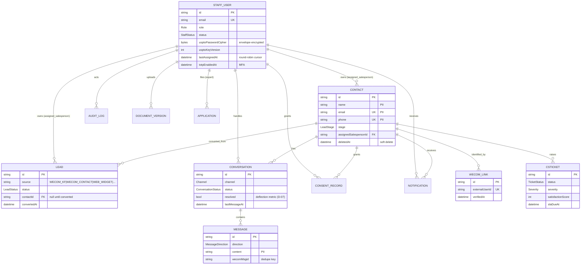
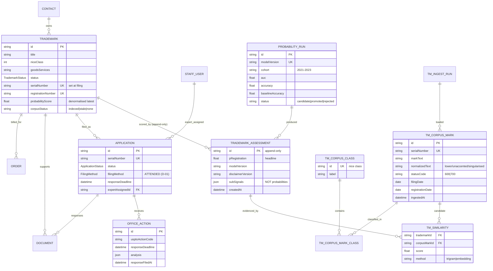
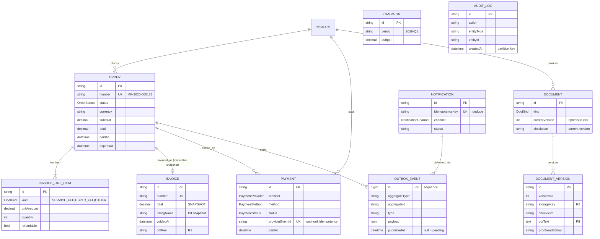

# 02 — Data Model Specification

| Field | Value |
| --- | --- |
| Document | `docs/architecture/02-data-model.md` |
| Revision | **A** |
| Baseline schema | `packages/db/prisma/schema.prisma` @ `091d0f8` ("P0 v1"), unchanged by the uncommitted P0.5 working tree of 2026-09-27 |
| Status | **APPROVED** — §5 is the binding P0.3 migration backlog |

---

## 1. Conventions (normative)

| Concern | Rule |
| --- | --- |
| Primary keys | `cuid()` for internal entities. **Never** expose a sequential id as a capability token. |
| Public identifiers | Human-facing numbers use a dedicated Postgres sequence, never `count+1`: `Order.number = "MK-" + year + "-" + lpad(seq,6)`, `Invoice.number = "INV-" + year + "-" + lpad(seq,6)`. Uniqueness enforced by `UNIQUE`. |
| Money | Stored `Decimal(12,2)` + explicit `currency CHAR(3)`. Adapters convert provider minor units ↔ decimal exactly (`bigint` only). **No float arithmetic on money** (Mandate 14). |
| Instants (wall clock) | `timestamptz(3)` — Prisma annotation `@db.Timestamptz(3)`. The P0 v1 schema uses bare `DateTime` (= `timestamp(3)`, **no timezone**); the P0.3 migration in §5.4 converts every instant column. Until then: all writes are UTC, all reads assume UTC — a temporary, explicitly accepted hazard. |
| Dates (calendar) | `*Date String?` in ISO `YYYY-MM-DD` where the calendar date is legally meaningful (USPTO response deadlines, filing dates). Never store "date" as a midnight timestamp. |
| Business deadlines | `responseDeadline` = `timestamptz` at **23:59:59 America/New_York** on the statutory date, **plus** `responseDeadlineDate` (ISO) for display and D-14 notification math. |
| Soft delete | `deletedAt timestamptz` on `Contact`, `Trademark`, `Document`. Hard delete is permitted only for `Campaign`, `ConsentRecord` (superseded rows), and expired tokens. Every soft delete writes `AuditLog`. |
| Deactivation | `StaffUser.status = DISABLED` + `disabledAt`; never delete a staff row (audit continuity). |
| Enumerations | Prisma `enum` in Postgres. **Adding a value is a non-breaking migration**; renaming/removing is breaking and needs expand-then-contract. |
| JSON columns | Only for genuinely open-ended, non-queried payloads (`OfficeAction.analysis`, `Payment.rawEvent`, `Notification.payload`, `TrademarkAssessment.subSignals`). Anything that must be filtered, indexed, or joined gets real columns. JSON payloads are schema-versioned with a `v` key. |
| Arrays | `String[]` only for tags/aliases; anything needing counts or joins is a join table. |
| PII | See §1.1 — drives encryption, retention, and redaction rules. |
| Naming | `camelCase` fields; plural model names; no abbreviations except agreed: `ok`, `url`, `id`. Enums `SCREAMING_SNAKE`. |

### 1.1 PII classification (drives §11 of `01-system-design.md`)

| Classification | Fields | Storage | Logging | LLM |
| --- | --- | --- | --- | --- |
| **Direct PII** | `Contact.name`, `email`, `phone`, `wechatAlias`, `Message.content`, `DocumentVersion.ocrText`, `WeComLink.externalUserId` | plaintext at rest (R2/PG volume encryption + disk encryption), row-scoping by owner | **never** logged (ids only) | **never** sent |
| **Business-confidential** | `Trademark.title`, `goodsServices`, `imageText`, `OfficeAction.bodyText` | plaintext, tenant-scoped | metadata only | mark text may be sent **only** with explicit client consent captured at assessment submission (`ConsentRecord(PIPL_PRIVACY)`) and only through the redaction pipeline |
| **Credentials** | `StaffUser.usptoPasswordCipher`, `passwordHash`, `totpSecretCipher` | envelope-encrypted (KMS) | never | never |
| **Financial** | `Payment.*`, `Invoice.*`, `Campaign.budget` | plaintext, audit-logged | amounts only, never provider payloads | never |
| **Public** | `TmCorpusMark.*` (USPTO published data) | plaintext | counts only | allowed |

---

## 2. Entity-relationship diagrams

### 2.1 CRM & identity



### 2.2 IP, assessment & filings



### 2.3 Commerce, documents & operations



---

## 3. Relationship cardinality and cascade rules

| Relationship | Cardinality | On delete | Rationale |
| --- | --- | --- | --- |
| `StaffUser → Contact/Lead/Conversation` | 1 : many | `SetNull` (assignment cleared) | reassignment must never delete client data |
| `Contact → Trademark/Document/Order/Conversation` | 1 : many | `Restrict` | a client with financial or filing history cannot be deleted; soft delete only |
| `Trademark → Application` | 1 : many | `Restrict` | serial numbers are permanent; never cascade from client deletion |
| `Application → OfficeAction` | 1 : many | `Cascade` | OA rows have no meaning without the application |
| `Document → DocumentVersion` | 1 : many | `Cascade` | versions are internal to the document; R2 objects garbage-collected by a 30-day job |
| `Order → InvoiceLineItem` | 1 : many | `Cascade` | draft order line items are ephemeral |
| `Order → Invoice` | 1 : 1 | `Restrict` | issued invoices are immutable legal records |
| `Order/Invoice/Payment → Contact` | many : 1 | `Restrict` | retention obligation (5 years) outranks deletion |
| `TmSimilarity` cache rows | many : 1 | `Cascade` from `TrademarkAssessment` | derived data, recomputable |
| `OutboxEvent` | append-only | row-level `DELETE` after 7 days | never cascades |

---

## 4. Index strategy

### 4.1 Query pattern → index map (every index must serve a named query)

| # | Query (owner) | Index |
| --- | --- | --- |
| Q1 | assigned leads for rep, newest first, status filter (`crm`) | `lead (assigned_salesperson_id, status, created_at DESC)` |
| Q2 | contact detail + stage (`crm`) | `contact (assigned_salesperson_id, stage)`, `contact (stage)` |
| Q3 | conversation list for rep, open first (`crm`) | `conversation (assigned_salesperson_id, status, last_message_at DESC)` |
| Q4 | message history paging (`crm`) | `message (conversation_id, created_at)` **+ unique `(conversation_id, wecom_msgid)`** |
| Q5 | duplicate WeCom identity lookup (`integrations`) | `unique wecom_link (external_user_id)` |
| Q6 | trademark search by owner (`trademarks`) | `trademark (contact_id)`, `trademark (nice_class, status)` |
| Q7 | corpus similarity search, **P5 critical** | `pg_trgm` GIN on `tm_corpus_mark.normalized_text` (`gin_trgm_ops`) + B-tree on `(nice_class, status_code)`; candidate narrowing by class first, then trigram similarity ≤ 100 rows per page |
| Q8 | applications by status, due-soon (`filings`) | `application (status)`, `application (next_reminder_at)`, `application (expert_assigned_id, status)` |
| Q9 | OA deadline sweep (`filings`) | `office_action (response_deadline)` **+ unique `(application_id, uspto_action_code, response_deadline)`** (idempotent upsert) |
| Q10 | orders by contact / status (`commerce`) | `order (contact_id, created_at DESC)`, `order (status, created_at DESC)`, `unique (number)` |
| Q11 | payment webhook dedupe (`commerce`) | `unique payment (provider_event_id)` |
| Q12 | reconciliation sweep (`commerce`) | `payment (status, created_at)`, `payment (paid_at) WHERE status='SUCCEEDED'` partial for daily settlement matching |
| Q13 | document versions, dedupe on re-upload (`documents`) | `unique document_version (document_id, version_no)`, `unique document_version (document_id, checksum)` |
| Q14 | notification inbox, unread count (`notifications`) | `notification (user_id, status, created_at DESC)`, `unique (idempotency_key)` |
| Q15 | audit search, admin only (`audit`) | `audit_log (actor_id, created_at DESC)`, `audit_log (entity_type, entity_id)`, BRIN on `created_at` (monthly partitions) |
| Q16 | outbox relay poll (`worker`) | `outbox_event (published_at, id) WHERE published_at IS NULL` partial index |
| Q17 | vault read audit (`audit`) | `audit_log (action, created_at DESC) WHERE action LIKE 'VAULT_%'` partial |
| Q18 | corpus freshness (`admin`) | `tm_ingest_run (run_date DESC)` |

### 4.2 Rules

1. **No index without a query.** An index proposed in a PR without a Q-number in this table is rejected.
2. **Partial indexes** for hot boolean/status filters (`WHERE published_at IS NULL`, `WHERE status = 'SUCCEEDED'`).
3. **Covering indexes** only for the two hottest reads (Q1, Q12) via `INCLUDE`.
4. **`pg_trgm` before OpenSearch.** Trigram is sufficient to 1.2M marks (§1.3 of `01-system-design.md` defines the upgrade trigger). `unaccent` extension + a `normalized_text` column computed at ingest — never `ILIKE '%…%'` at query time.
5. **Autovacuum:** `autovacuum_vacuum_scale_factor = 0.02` on high-churn tables (`message`, `payment`, `audit_log`, `outbox_event`, `notification`). Hot-update bloat on `audit_log` is a known failure mode; partitioning (below) is the mitigation.
6. **Index build on large tables** must use `CREATE INDEX CONCURRENTLY` (never inside a transactional migration); the migration runner detects `CONCURRENTLY` statements and runs them outside the transaction (§7).

---

## 5. P0.3 migration backlog (binding)

> Deliverable: a single reviewed PR creating `packages/db/prisma/migrations/0P3__*/migration.sql` (expand-only, §7). `schema.prisma` remains authoritative after merge. This section is the acceptance specification; the Developer writes the migration, the Architect reviews it.

### 5.1 New models

```prisma
// --- Eventing -------------------------------------------------------------
model OutboxEvent {
  id            BigInt   @id @default(autoincrement())
  aggregateType String
  aggregateId   String
  type          String
  payload       Json
  traceId       String?
  attempts      Int      @default(0)
  publishedAt   DateTime? @db.Timestamptz(3)
  createdAt     DateTime @default(now()) @db.Timestamptz(3)

  @@index([publishedAt, id])
  @@index([aggregateType, aggregateId])
}

// --- Scoring (D-03) -------------------------------------------------------
model ProbabilityRun {
  id               String   @id @default(cuid())
  modelVersion     String   @unique
  cohort           String   @default("2021-2023")
  trainedAt        DateTime? @db.Timestamptz(3)
  auc              Float?
  accuracy         Float?
  baselineAccuracy Float?
  calibrationJson  Json?    // per-bucket observed vs predicted
  sampleSize       Int?
  status           String   @default("candidate") // candidate | promoted | rejected
  evaluatedAt      DateTime? @db.Timestamptz(3)
  notes            String?
  createdAt        DateTime @default(now()) @db.Timestamptz(3)
}

model TrademarkAssessment {
  id                String   @id @default(cuid())
  trademarkId       String
  trademark         Trademark @relation(fields: [trademarkId], references: [id], onDelete: Cascade)
  pRegistration     Float    // 0..1, headline = P(eventual registration)
  subSignals        Json     // NON-probabilistic features; never rendered as %
  modelVersion      String
  runId             String?
  run               ProbabilityRun? @relation(fields: [runId], references: [id])
  disclaimerVersion String
  featureSnapshot   Json     // corpus version, top candidates, class
  requestedById     String?
  createdAt         DateTime @default(now()) @db.Timestamptz(3)

  similarities      TmSimilarity[]
  @@unique([trademarkId, modelVersion, createdAt])  // append-only, replay-safe
  @@index([trademarkId, createdAt(sort: Desc)])
}

// --- USPTO corpus (D-02, A1) ---------------------------------------------
model TmCorpusMark {
  id                String   @id @default(cuid())
  serialNumber      String   @unique
  registrationNumber String?
  markText          String
  normalizedText    String
  statusCode        String   // "600" pending | "700" registered
  filingDate        DateTime? @db.Date
  registrationDate  DateTime? @db.Date
  abandonDate       DateTime? @db.Date
  goodsSummary      String?
  sourceFile        String
  ingestedAt        DateTime @default(now()) @db.Timestamptz(3)
  ingestRunId       String?

  classes           TmCorpusMarkClass[]
  similarities      TmSimilarity[]

  @@index([statusCode, filingDate(sort: Desc)])
  @@index([ingestedAt])
}

model TmCorpusClass {
  id      String @id            // Nice class, e.g. "025"
  label   String
  marks   TmCorpusMarkClass[]
}

model TmCorpusMarkClass {
  markId  String
  classId String
  mark     TmCorpusMark @relation(fields: [markId], references: [id], onDelete: Cascade)
  class    TmCorpusClass @relation(fields: [classId], references: [id], onDelete: Cascade)
  @@id([markId, classId])
  @@index([classId])
}

model TmSimilarity {
  id           String   @id @default(cuid())
  assessmentId String
  assessment   TrademarkAssessment @relation(fields: [assessmentId], references: [id], onDelete: Cascade)
  corpusMarkId String
  corpusMark   TmCorpusMark @relation(fields: [corpusMarkId], references: [id], onDelete: Cascade)
  score        Float
  method       String   // trigram | bge
  computedAt   DateTime @default(now()) @db.Timestamptz(3)
  @@unique([assessmentId, corpusMarkId, method])
  @@index([assessmentId, score(sort: Desc)])
}

model TmIngestRun {
  id            String   @id @default(cuid())
  runDate       DateTime @db.Date
  status        String   @default("running") // running | complete | failed
  filesProcessed Int     @default(0)
  marksUpserted Int      @default(0)
  marksSkipped  Int      @default(0)
  errorLog      Json?
  startedAt     DateTime @default(now()) @db.Timestamptz(3)
  finishedAt    DateTime? @db.Timestamptz(3)
  @@unique([runDate])
  @@index([status, startedAt])
}

// --- Assignment round-robin (D-06) ---------------------------------------
model AssignmentState {
  staffId     String   @id
  activeLeads Int      @default(0)
  lastAssignedAt DateTime? @db.Timestamptz(3)
  version     Int      @default(0)
  @@index([activeLeads, lastAssignedAt])
}

// --- Feature flags --------------------------------------------------------
model FeatureFlag {
  name            String   @id
  enabled         Boolean  @default(false)
  rolloutPercent  Int      @default(0)   // 0..100, staff-id hash
  allowedRoles    String[] @default([])
  updatedById     String?
  note            String?
  updatedAt       DateTime @updatedAt @db.Timestamptz(3)
}
```

### 5.2 Column additions to existing models

| Model | Addition | Reason |
| --- | --- | --- |
| `StaffUser` | `disabledAt timestamptz`, `totpSecretCipher bytes?`, `totpEnabledAt timestamptz`, `lastAssignedAt timestamptz`, `vaultStepUpAt timestamptz`, `vaultRotatedAt timestamptz` | MFA (Mandate 8), 5-min step-up before vault reveal, 90-day rotation (D-01) |
| `Contact` | `deletedAt timestamptz`, `deletedById string?` | soft delete + PIPL erasure workflow |
| `Trademark` | `deletedAt timestamptz`, `consentForCorpusAt timestamptz?` | mark text may only be sent to the LLM with recorded consent (§1.1) |
| `Application` | `filingMethod string @default("ATTENDED")`, `filingSessionId string? @unique`, `filingStartedAt`, `filedById string?`, `receiptKey string?`, `filingChecklist json?` | attended-filing ceremony (§6.2 of `01`) |
| `OfficeAction` | `responseDeadlineDate string?`, `rawActionKey string?` | calendar fidelity + dedupe |
| `Order` | `expiresAt timestamptz`, `cancelReason string?`, `displayRateCny decimal? @db.Decimal(12,6)`, `displayRateAsOf timestamptz?` | D-05 CNY display must be reproducible server-side |
| `Invoice` | `subtotal decimal(12,2)`, `total decimal(12,2)`, `currency char(3)`, `billingName string`, `billingEmail string?`, `voidedAt timestamptz?`, `issuedById string?` | immutable legal snapshot (Mandate 15) |
| `Notification` | `idempotencyKey string @unique` | dedupe (Q14) |
| `Message` | `redactedAt timestamptz?` | PIPL erasure inside archived content |
| `Document` | `deletedAt timestamptz`, `version int @default(1)` | optimistic concurrency (Q13) |
| `AuditLog` | `requestId string?`, `traceId string?`, `outcome string?` (`success`/`denied`/`error`) | correlation + denied-access forensics |
| `ConsentRecord` | `policyVersion string`, `source string` | consent must name the policy version (PIPL) |

### 5.3 New uniqueness / check constraints (idempotency & invariants)

```sql
-- Webhook replay is a no-op
CREATE UNIQUE INDEX ux_payment_provider_event  ON "Payment" ("providerEventId") WHERE "providerEventId" IS NOT NULL;
-- OA upsert from TSDR/ODP is idempotent
CREATE UNIQUE INDEX ux_office_action_key       ON "OfficeAction" ("applicationId","usptoActionCode","responseDeadline");
-- Message dedupe from WeCom callbacks
CREATE UNIQUE INDEX ux_message_wecom           ON "Message" ("conversationId","wecomMsgid") WHERE "wecomMsgid" IS NOT NULL;
-- Re-uploading identical bytes creates no new version
CREATE UNIQUE INDEX ux_docver_checksum         ON "DocumentVersion" ("documentId","checksum");
-- Public numbers
CREATE UNIQUE INDEX ux_order_number            ON "Order" ("number");
CREATE UNIQUE INDEX ux_invoice_number          ON "Invoice" ("number");
-- Money sanity
ALTER TABLE "Order"   ADD CONSTRAINT ck_order_nonneg  CHECK ("subtotal" >= 0 AND "total" >= 0);
ALTER TABLE "Payment" ADD CONSTRAINT ck_pay_nonneg   CHECK ("amount"  >  0);
ALTER TABLE "TrademarkAssessment" ADD CONSTRAINT ck_score_range CHECK ("pRegistration" >= 0 AND "pRegistration" <= 1);
-- Public number sequences
CREATE SEQUENCE seq_order_number   START 1;
CREATE SEQUENCE seq_invoice_number START 1;
```

### 5.4 Timezone conversion migration (`timestamp(3)` → `timestamptz(3)`)

Rationale: Postgres `timestamp without time zone` silently accepts local-time writes; with a HK/China/ET team this produces untraceable 8-hour errors on statutory deadlines. Convert every instant column, then pin the Prisma annotations.

```sql
-- executed in dependency-safe order, table by table
ALTER TABLE "AuditLog"        ALTER COLUMN "createdAt"  TYPE timestamptz(3) USING "createdAt" AT TIME ZONE 'UTC';
ALTER TABLE "Notification"    ALTER COLUMN "createdAt"  TYPE timestamptz(3) USING "createdAt" AT TIME ZONE 'UTC';
ALTER TABLE "Message"         ALTER COLUMN "createdAt"  TYPE timestamptz(3) USING "createdAt" AT TIME ZONE 'UTC';
ALTER TABLE "OutboxEvent"     ALTER COLUMN "createdAt"  TYPE timestamptz(3) USING "createdAt" AT TIME ZONE 'UTC';
-- … repeat for every DateTime column in schema.prisma
```

Then, in `schema.prisma`, annotate **every** instant field with `@db.Timestamptz(3)`, and `filingDate`/`registrationDate`/`responseDeadlineDate`-style calendar fields with `@db.Date` or `String` (§1).

**Acceptance test:** `SELECT now() - max("responseDeadline") FROM "OfficeAction"` must be timezone-independent; a row inserted by a CI job running with `TZ=Asia/Hong_Kong` must equal the same insert with `TZ=America/New_York`.

---

## 6. Partitioning and retention

| Table | Strategy | Retention | Rationale |
| --- | --- | --- | --- |
| `AuditLog` | **monthly RANGE partitions** on `createdAt` + BRIN | 24 months hot → archive to R2 (Parquet) for 5 years | unbounded growth; compliance needs 5-year retrievability, not 5-year hot rows |
| `Message` | monthly partitions once > 10M rows | 24 months content, then `[redacted]` tombstone | 会话存档 content is the heaviest PII store |
| `OutboxEvent` | none | rows deleted 7 days after `publishedAt` | relay guarantees only need short replay |
| `Notification` | none | 90 days | inbox is a convenience, `CSTicket` is the record |
| `TmCorpusMark` | none; `ingestedAt` index + `VACUUM` | LIVE corpus only (600+700) | dead records are deleted on ingest (`statusCode` ∉ {600,700} → delete) |
| `TmSimilarity` | none | 180 days, then recompute | derived cache |
| `TrademarkAssessment` | none | **permanent** (append-only) | model accountability; required to explain any historical score |
| `Invoice`, `Payment`, `Order`, `Application`, `OfficeAction`, `Document` | none | **5 years minimum**, then legal hold review | trademark record retention obligations |
| `Contact` | none | 5 years after last activity; PIPL erasure request → hard-delete PII columns, keep FK stubs with pseudonymous ids | PIPL Arts. 47 + D-04 |

**Partition maintenance job (monthly, `worker`):** create next 2 months' partitions ahead of time, archive+drop partitions older than hot retention, alert if a partition is missing (fail writes loudly, never silently create at insert time).

---

## 7. Migration protocol

1. **Expand-then-contract.** Release *n* adds nullable columns/tables; release *n+1* backfills and switches reads; release *n+2* removes. Destructive DDL (`DROP`, narrowing `TYPE`, `NOT NULL` on existing rows) is forbidden in the same release as the code that stops using the column.
2. **One migration per concern**, named `0P3__<concern>`. Forward-only in CI; every migration must have a documented rollback (or an explicit "irreversible, restore-from-backup" note).
3. **Locking discipline:** add columns/tables with `NULL`-able or default-`NULL` and no `NOT NULL` rewrite on large tables; index creation uses `CONCURRENTLY`; the runner takes `pg_advisory_lock(<fixed id>)` so CI, staging and prod can never race.
4. **Zero-downtime rule:** any migration touching a table with > 100k rows must state its lock level (`ACCESS EXCLUSIVE` seconds) and its `lock_timeout`. Migrations exceeding 2 s of `ACCESS EXCLUSIVE` on a live table require a two-step (add → backfill in batches → swap).
5. **Backfill in batches** (1 000 rows per transaction, 100 ms pause) with progress recorded in `OutboxEvent`-style bookkeeping so a failed run resumes.
6. **CI gate:** `prisma migrate diff` from the previous tag must be empty after applying migrations to a fresh DB — i.e. schema and migrations can never drift. `prisma validate` + `migrate reset` on testcontainers in the integration job.
7. **Data backfill of `Trademark.probabilityScore`** (P0 v1 column) → `TrademarkAssessment` rows is a one-off script in `packages/db/scripts/`, idempotent (`WHERE modelVersion = 'bootstrap'`), logged, and reversible by deletion (scores are derived, never source of truth).

---

## 8. Query plans the Architect will audit (acceptance criteria)

| Query | Budget | Verification |
| --- | --- | --- |
| Assigned leads list (Q1) | < 50 ms @ 10k leads per rep | `EXPLAIN (ANALYZE, BUFFERS)` uses the composite index, no sequential scan |
| Corpus similarity search (Q7) | < 800 ms p95, ≤ 200 candidates | `SET LOCAL statement_timeout = '2s'`; uses GIN trigram; row estimate < 5k before scoring |
| OA deadline sweep (Q9) | full sweep < 30 s @ 50k applications | index-only scan on `response_deadline` partial |
| Audit search (Q15) | < 300 ms @ 5M rows | partition pruning visible in plan |
| Webhook upsert (Q11) | < 20 ms | index-only, no seq scan under concurrency test of 200 rps |
| Assignment transaction (Q: round-robin) | < 100 ms, no deadlock under 50 concurrent assigns | `FOR UPDATE SKIP LOCKED` on `AssignmentState`; deadlock detector in the integration suite |

---

`[ARCHITECT APPROVED: READY FOR DEVELOPER IMPLEMENTATION]`
