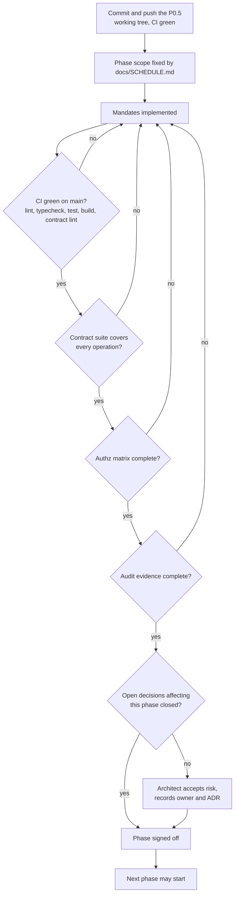
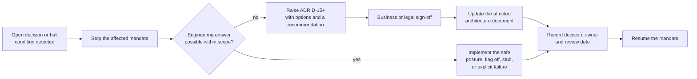

# Implementation Mandates

**Document ID:** `ARCH-04`
**Status:** APPROVED — binding on Developer and QA
**Date:** 2026-09-27
**Code baseline at approval:** last pushed commit `d8598b6` — the P0 scaffold plus the tracked part
of the 2026-09-27 P0.5 platform hardening (`.env.example`, `.gitattributes`, `ci.yml`,
`docker-compose.yml`, `apps/api`, `workers`, `pnpm-lock.yaml`). The rest of that working tree —
`packages/config/`, `scripts/`, `eslint.config.mjs`, `infra/Dockerfile.web`, `infra/Dockerfile.worker`,
`infra/compose.staging.yml`, `infra/scripts/`, `infra/README.md`, `packages/db/prisma/migrations/`,
`packages/db/scripts/`, `docs/runbooks/`, `.dockerignore`, `.github/dependabot.yml`,
`.github/workflows/deploy-staging.yml`, `apps/web/public/` — was **still uncommitted as of the D-15
amendment `2f4862d`** and **must be committed and pushed before implementation starts**; see §16.
This package landed at `8b312ff`.
**Audience:** Developer (implementation), QA (verification), Architect (change control)
**Supersedes:** nothing; extends `ARCH-01`, `ARCH-02`, `ARCH-03`

> Implementation code is explicitly out of scope for the Architect. This document states *what* must
> be true, *who* verifies it, and *how* failure is detected. It does not prescribe language-level
> structure beyond what the stack mandates already fix.

---

## 1. How to read this document

Every mandate has a stable identifier. Identifiers never change meaning; a superseded mandate keeps
its number and gains a `Status: SUPERSEDED by M<x.y>` line plus a pointer to the replacement.

| Field | Meaning |
| --- | --- |
| **Statement** | The single normative outcome. Written so that it can be falsified by a test. |
| **Owner** | `DEV` (Developer), `QA` (Quality), `SRE` (platform/DevOps), `ARCH` (Architect decision required). |
| **Phase** | The phase in `docs/SCHEDULE.md` that owns delivery. |
| **Depends on** | Mandate IDs that must be green first. |
| **Verification** | The automated check that proves the statement. `QA` mandates must be automatable. |
| **Halt** | Condition that stops the phase and returns to the Architect. |

Severity is expressed as a gate: `GATE` (work cannot proceed without it), `BLOCKER` (phase cannot be
signed off without it), `MAJOR` (must be fixed before the next phase starts), `MINOR` (tracked).

### Non-negotiable global rules

These repeat mandates deliberately; violating any of them fails the phase review.

| # | Rule | Why |
| --- | --- | --- |
| G1 | No automated or unattended USPTO filing. Every submission is performed by a human attorney inside a `filing-session` ceremony. | 37 CFR 2.193, D-01 |
| G2 | USPTO MFA seeds are never accepted, stored, logged or requested by any API shape. | D-01, security |
| G3 | No client PII is sent to any third-party LLM. Mark text and business context only, and only after recorded consent. | D-04, PIPL |
| G4 | Every authenticated operation enforces permission in three layers: edge, API middleware, SQL scope. Deny by default. | ARCH-01 §5.3 |
| G5 | Money crosses the wire as a decimal string plus currency. JSON floats for money are a review-blocking defect. | D-05 |
| G6 | No probability, similarity or recommendation is ever presented as legal advice. Disclaimer and model version ship with the payload. | D-03 |
| G7 | All instants are RFC 3339 UTC; all money operations are idempotent; all state transitions are server-owned. | ARCH-01 §5.2, §7 |
| G8 | Third-party analytics is prohibited. Only the first-party beacon in `ARCH-03` may be used. | D-07 |
| G9 | Tests, lint, typecheck and build are green on `main` before merge. No manual-only verification for a `QA` mandate. | D-14 |
| G10 | Every schema change ships with a reversible migration, an updated `ARCH-02` delta, and a rollback note. | ARCH-02 §7 |

---

## 2. Foundation and contract conformance

### M1.1 — Contract-first handler generation (GATE)
**Statement:** Every `ARCH-03` operation is implemented against the published contract; no handler is
written against a divergent local type. The contract file is the single source of truth and is
diffed in CI.
**Owner:** DEV · **Phase:** P1 · **Depends on:** none
**Verification:** CI step fails when `docs/architecture/03-api-contract.yaml` changes in a pull
request without a matching change in `apps/api` route registrations, and contract lint runs
(OpenAPI 3.1 parse, `$ref` resolution, no undeclared path parameters, no operation without
`x-contract-status`).
**Halt:** If a handler needs a field that `ARCH-03` does not define, the contract is revised first
(Architect sign-off), then the handler is written.

### M1.2 — Error contract uniformity (GATE)
**Statement:** Every error response is `application/problem+json` with a `code` from the closed enum
in `ARCH-03` (`Problem.code`) and a `traceId` that appears in structured logs.
**Owner:** DEV · **Phase:** P1 · **Depends on:** M1.1
**Verification:** Contract test enumerating every non-2xx response in `ARCH-03` and asserting
`content.application/problem+json.schema.code` is present and enumerated; integration test asserting
`traceId` correlates with the log record for a forced error.
**Halt:** Any ad-hoc error shape (for example `{ error: "..." }`) fails the review.

### M1.3 — Pagination contract (MAJOR)
**Statement:** No list endpoint uses offset pagination. Every list returns
`{ items, nextCursor? }`, honours `?cursor=&limit=` with `limit` in `[1, 100]`, and returns a stable
ordering so a cursor never skips or repeats a row.
**Owner:** DEV · **Phase:** P1 · **Depends on:** M1.1
**Verification:** Property test: page through a seeded 1 000-row table twice with interleaved inserts
and assert no duplicates and no silent omissions; assert `limit=101` yields `400 VALIDATION_FAILED`.

### M1.4 — Optimistic concurrency (MAJOR)
**Statement:** Every mutable aggregate in `ARCH-02` carries `version`. Updates require `If-Match`
(or an explicit `baseVersion` where the contract declares it) and a mismatch returns
`409 VERSION_MISMATCH` with the current representation under `extensions.current`.
**Owner:** DEV · **Phase:** P1 · **Depends on:** M1.1, M1.2
**Verification:** Two-client test: read, mutate from client A, attempt the same mutation from client
B, assert B receives `409` and that A's write is not lost.
**Halt:** Last-write-wins on any aggregate is a review-blocking defect.

### M1.5 — Observability contract (MAJOR)
**Statement:** Every request emits a structured log line containing `traceId`, `actorId`, `role`,
`route`, `method`, `status`, `durationMs`, and the redaction rules of ARCH-01 §11 are applied
before serialisation. Request and response bodies are never logged on authenticated routes.
**Owner:** DEV + SRE · **Phase:** P1 · **Depends on:** M1.2
**Verification:** Log-sampling test asserting that a fixture containing e-mail, phone, magic-link
token, card number and vault secret never appears in captured logs.

### M1.6 — One Node major, pinned everywhere (GATE)
**Statement:** The runtime baseline is a single Node major, identical in `package.json`
`engines.node`, every `package.json` in the workspace, `turbo.json` if applicable, the CI
`node-version`, every `infra/Dockerfile.*` base image, and the local and staging compose files. No
file may pin a different major.
**Owner:** DEV + SRE · **Phase:** P0.3 · **Depends on:** none
**Current state:** the working tree pins **Node 20** everywhere (`engines.node >= 20`,
`node:20-alpine` in all three Dockerfiles, `node-version: 20` in CI), while GitHub Actions has
flagged the Node 20 runner as deprecated (annotation on run `36242996677`) and `01` recommends
moving to Node 22 LTS.
**Verification:** CI step that extracts the major from each of the six locations and fails on any
mismatch; a scheduled job that fails when the pinned runner image is announced as deprecated.
**Halt:** OPEN-06. The Architect's recommendation is Node 22 LTS, adopted in P0.3 as one atomic
change (engines, CI, all Dockerfiles, compose) with a green build before it merges.

---

## 3. Identity, sessions and the credential vault

### M2.1 — Deny-by-default authorization vocabulary reconciliation (GATE)
**Statement:** The `x-permission` vocabulary in `ARCH-03` becomes the single permission set in
`packages/core`. The P0 module currently ships 15 permissions; the contract requires the wider set
below. P0 handlers are migrated in the same change, with no permission silently granted that the
contract does not declare.

| P0 permission (`packages/core/src/rbac.ts`) | Contract `x-permission` | Disposition |
| --- | --- | --- |
| `staff.manage` | `staff.manage` | keep |
| `vault.uspto.read` | `vault.uspto.read` | keep |
| `vault.uspto.write` | `vault.uspto.write` | **add** |
| `case.read`, `case.file` | `case.read`, `case.file`, `case.respond` | keep, **add** `case.respond` |
| `contact.read.assigned`, `contact.read.all` | `contact.read`, `contact.write`, `contact.create`, `contact.delete` | **replace** with scope-based names plus `x-scope` |
| `lead.read.assigned`, `lead.read.all` | `lead.read`, `lead.create`, `lead.assign` | **replace** with scope-based names |
| `order.create` | `order.create`, `order.read`, `order.pay`, `order.invoice`, `order.refund` | **split** |
| `erp.pipeline`, `erp.budget`, `erp.tickets` | `crm.pipeline.read`, `crm.metrics.read`, `erp.budget.read`, `erp.budget.write`, `ticket.read`, `ticket.create` | **split** |
| `audit.read` | `audit.read` | keep |
| — | `trademark.read`, `trademark.write`, `trademark.assess`, `document.read`, `document.create`, `document.proofread`, `conversation.read`, `conversation.write`, `notification.read`, `notification.write`, `tm.search`, `tm.ingest.read`, `admin.jobs.read`, `admin.jobs.replay` | **add** |
| — | `self` | **add**; means "session valid, no additional permission" (only `/auth/me`, `/auth/staff/logout`) |

**Owner:** DEV + ARCH · **Phase:** P1 · **Depends on:** M1.1
**Verification:** Unit test over the matrix asserting, for every role, that the set of permissions
granted is a subset of the contract vocabulary; a table-driven test per role asserting allow/deny
for all four scopes (`own`, `all`, `assigned`, `cross-client`); a CI grep gate that every
`x-permission` value in `ARCH-03` exists in `packages/core`.
**Halt:** Role capability changes are Architect decisions (ADR D-15+), not Developer discretion.

### M2.2 — Session model (GATE)
**Statement:** Staff sessions use the `mkus_staff` cookie, client sessions use `mkus_portal`.
Cookies are `HttpOnly`, `Secure`, `SameSite=Lax`, host-only, and rotated on privilege change. Session
secrets live only in Redis with a rolling expiry and a server-side revocation list.
**Owner:** DEV · **Phase:** P1 · **Depends on:** M2.1
**Verification:** Integration test asserting cookie flags after login, after MFA completion, after
role change and after logout; test asserting the stored session is destroyed server-side and that
disabling a staff account kills live sessions in the same transaction.
**Halt:** Storing session state in Postgres or in a client-readable cookie is a review blocker.

### M2.3 — CSRF and same-origin discipline (GATE)
**Statement:** Every authenticated mutation requires header `x-csrf-token` bound to the session.
Cross-origin browser calls are rejected; the Next.js proxy is the only permitted writer of
`Set-Cookie`. Provider webhooks are exempt and must verify signatures instead.
**Owner:** DEV · **Phase:** P1 · **Depends on:** M2.2
**Verification:** Test suite asserting `403 CSRF_FAILED` for a missing, mismatched and replayed
token; assertion that the API never sets cookies for webhook responses.

### M2.4 — MFA and step-up (GATE)
**Statement:** TOTP is mandatory for `MASTER_ADMIN` and `EXPERT`. `SALESPERSON` is required to
enable it. Vault write, vault reveal, filing-session start and refund-above-threshold require a
step-up verification not older than 5 minutes, otherwise `428 STEP_UP_REQUIRED`.
**Owner:** DEV · **Phase:** P1 · **Depends on:** M2.2
**Verification:** Test matrix over every operation declaring `428`, asserting the code path; test
asserting a challenge is single-use with a 5-minute lifetime and that 5 wrong codes invalidate it.

### M2.5 — Vault encryption (GATE)
**Statement:** USPTO credentials are stored with envelope encryption: a per-attorney data key
encrypts the secret at rest (AES-256-GCM), and the data key is wrapped by the KMS key. A rotation
job re-wraps without re-encrypting plaintext. Decryption happens in memory only, is never cached,
and never reaches a log, an error body, an analytics event or a trace attribute.
**Owner:** DEV + SRE · **Phase:** P1 · **Depends on:** M2.4
**Verification:** Unit test with a stub KMS asserting ciphertext-at-rest differs from plaintext and
that a tampered ciphertext fails authentication; test asserting no secret material appears in
serialised logs, metrics labels or Sentry breadcrumbs (redaction test from M1.5).
**Halt:** KMS unavailability in production is an operational halt for filing, not a licence to
decrypt in the application tier.

### M2.6 — Anti-enumeration and abuse controls (MAJOR)
**Statement:** `/auth/magic-link` always answers `202` with a neutral body. Login, magic-link request
and redemption are rate limited per IP, per e-mail and per token exactly as declared in
`ARCH-03` `x-ratelimit`. Five failed logins lock the account for 15 minutes (`423 ACCOUNT_LOCKED`).
**Owner:** DEV + SRE · **Phase:** P1 · **Depends on:** M2.2
**Verification:** Test asserting identical response body, status and timing class for known and
unknown addresses; test asserting lockout after 5 failures and unlock after the window.

### M2.7 — Client portal isolation (GATE)
**Statement:** A `mkus_portal` session can read only its own contact, its own marks, documents,
orders, invoices, tickets and conversations. Every client-facing query is scoped by `contactId` in
SQL, never by post-filtering. Attempting to address another contact's identifier returns `404`.
**Owner:** DEV + QA · **Phase:** P1 · **Depends on:** M2.1, M2.2
**Verification:** Systematic IDOR suite enumerating every client-reachable endpoint with a foreign
identifier (including a valid signature on the path parameter), asserting `404` and asserting the
absence of any row data in the body; SQL-level assertion that the generated query contains the
`contactId` predicate.

---

## 4. Data, migrations and integrity

### M3.1 — Migration protocol (GATE)
**Statement:** Prisma is the only schema authority. Every migration is forward-only in the
repository, reversible in the runbook, applied by `prisma migrate deploy` in an automated step, and
reviewed for lock level before merge. A migration that takes an `ACCESS EXCLUSIVE` lock on a table
above 1 000 000 rows must be split into additive, backfill, cutover phases.
**Owner:** DEV + SRE · **Phase:** P1 · **Depends on:** none
**Verification:** CI applies migrations to an empty database and to a snapshot with production-like
row counts, asserting success and a recorded duration; a lint step asserts every migration has a
matching rollback note in `docs/architecture/02-data-model.md` or the runbook.
**Halt:** A destructive migration without a reviewed backfill and rollback plan halts the phase.

### M3.2 — P0.3 backlog delivery (GATE)
**Statement:** The P0.3 migration backlog in `ARCH-02` §5 is delivered as one reviewed series
before P1 handlers depend on it: `OutboxEvent`, `ProbabilityRun`, `TrademarkAssessment`,
`TrademarkAssessmentFactors`, `TmCorpusMark`, `TmCorpusClass`, `TmCorpusMarkClass`, `TmSimilarity`,
`TmIngestRun`, `AssignmentState`, `FeatureFlag`, plus the column additions, soft deletes, MFA and
vault columns, invoice snapshot column, notification dedupe key, and `timestamptz` conversions.
**Owner:** DEV · **Phase:** P1 · **Depends on:** M3.1
**Verification:** Schema diff test comparing the migrated database against the Prisma schema (zero
drift); `ARCH-02` §5 checklist ticked with per-item evidence links.
**Halt:** Any item deferred out of P0.3 requires an ADR and a re-sequenced `docs/SCHEDULE.md`.

### M3.3 — Monetary exactness (BLOCKER)
**Statement:** Amounts are stored as `Decimal(14, 2)` in the database and serialised as decimal
strings. Currency arithmetic happens in integer minor units inside the service; floating point is
banned for money by lint rule and by test.
**Owner:** DEV + QA · **Phase:** P4 · **Depends on:** M3.1
**Verification:** Property test generating 10 000 random (amount, discount, tax, currency)
combinations and asserting the total equals the sum of lines exactly in minor units; a lint rule
fails the build on `parseFloat`, `toFixed` or float-typed money fields.

### M3.4 — Transactional outbox (GATE)
**Statement:** Domain state and its event are written in one transaction to `OutboxEvent`. A
dispatcher publishes to BullMQ with an at-least-once guarantee. Consumers are idempotent on
`idempotencyKey` and rely on unique constraints, so a duplicate delivery is a no-op.
**Owner:** DEV · **Phase:** P1 · **Depends on:** M3.2
**Verification:** Fault-injection test killing the worker between DB commit and publish, then
asserting eventual delivery exactly once at the consumer's effect level (one row, one e-mail, one
audit entry); test asserting `replayedAt` is set and the payload is immutable on replay.

### M3.5 — Soft delete and erasure (MAJOR)
**Statement:** Deletion is soft (`deletedAt`) and scope filters exclude soft-deleted rows by
default. P8 erasure scrubs PII columns while retaining legally required financial records
(invoices, payments, audit), with a documented retention basis per column.
**Owner:** DEV + ARCH · **Phase:** P8 · **Depends on:** M3.1
**Verification:** Test asserting deleted rows are invisible to every list and detail query; erasure
test asserting each PII column in the erasure matrix is nulled and each retained column is intact.

### M3.6 — Time and locale correctness (MAJOR)
**Statement:** Instants are `timestamptz` in UTC; business dates (filing date, response deadline,
Nice-class periods) are calendar dates and are never shifted by timezone conversion. Display
timezone is `Asia/Hong_Kong` for staff UI and derived per recipient for notifications.
**Owner:** DEV + QA · **Phase:** P1 · **Depends on:** M3.2
**Verification:** Test across at least four zones asserting an OA due date stored as a date reads
back identically, and that a deadline 23:59 local produces exactly one reminder in the correct
window.

---

## 5. CRM, intake and conversations

### M4.1 — Lead capture and the 5-minute assignment NFR (GATE)
**Statement:** A lead is created and assigned in the same transaction, using a weighted round-robin
policy with per-salesperson capacity and availability. The elapsed time from `createdAt` to
`assignedAt` is recorded and exported to the funnel metrics.
**Owner:** DEV · **Phase:** P1 · **Depends on:** M2.1, M3.4
**Verification:** Concurrency test enqueueing 1 000 simultaneous leads across 5 salespeople,
asserting exactly-once assignment, no salesperson exceeding capacity, and `p95AssignmentMinutes`
at or below 5 in the metrics rollup; test asserting a manual override writes `LEAD_REASSIGNED` with
a mandatory reason.
**Halt:** If capacity is exceeded, the lead stays in the unassigned queue and raises an alert; it is
never silently dropped.

### M4.2 — WeCom as primary intake (GATE)
**Statement:** Inbound WeCom messages create or link a `Contact` and a `Lead` and a `Conversation`,
deduplicated on `(wechatOpenId, msgId)`. The callback handshake and message signature verification
follow the vendor specification. Deduplication is enforced by a unique constraint, not by
application-level checks alone.
**Owner:** DEV · **Phase:** P3 · **Depends on:** M3.4
**Verification:** Replay test delivering the same vendor payload 10 times and asserting exactly one
`Message`, one `Conversation` and no duplicate `Lead`; signature-negative tests; test asserting the
XML is parsed defensively (unknown element types are ignored, not fatal).
**Halt:** WeCom API credential provisioning is a business dependency; without it, P3 intake cannot
be signed off even if the code is complete.

### M4.3 — Conversation deflection metric integrity (BLOCKER)
**Statement:** A conversation may be closed as `DEFLECTED` only when no human reply was sent
(`handledByStaff = false`). Any human reply forces `resolution = HUMAN`. The D-07 deflection rate is
derived from these two facts and from nothing else.
**Owner:** DEV + QA · **Phase:** P3 · **Depends on:** M4.2
**Verification:** Test attempting `DEFLECTED` with a prior outbound staff message, asserting `400`;
metric test asserting a hand-built fixture of N conversations yields the expected rate.

### M4.4 — Scope-safe listings (GATE)
**Statement:** Every CRM list endpoint applies the actor's scope in SQL (`assignedSalespersonId =
actor` unless `scope=all` and the role permits it). A `SALESPERSON` requesting `scope=all` receives
their own rows, not an error and not other people's rows.
**Owner:** DEV + QA · **Phase:** P1 · **Depends on:** M2.1
**Verification:** Two-tenant test with 2 salespeople and 1 expert asserting row sets per role and per
`scope`, and asserting the query plan index usage for the scoped predicate.

### M4.5 — Stage machine integrity (MAJOR)
**Statement:** Stage transitions are validated server-side against the pipeline order in
`ARCH-03` `LeadStage`. Illegal transitions return `409`. The timeline is derived from events, never
edited directly.
**Owner:** DEV · **Phase:** P3 · **Depends on:** M4.1
**Verification:** Table-driven test over all legal and illegal transitions, asserting the timeline
event count and ordering after a randomised transition sequence.

---

## 6. Marks, documents and proofing

### M5.1 — Document upload pipeline (GATE)
**Statement:** Uploads are two-step: a presigned slot, then direct-to-storage bytes, then
`complete`. The API never proxies file bytes. A version becomes `READY` only after size, MIME
sniffing, SHA-256 verification and an antivirus scan pass. Storage is private; access is a
5-minute presigned URL, and every download is audited (`DOCUMENT_DOWNLOADED`).
**Owner:** DEV + SRE · **Phase:** P2 · **Depends on:** M2.3
**Verification:** Integration test uploading a 25 MB PDF, a 26 MB file (rejected `413`), a
mismatched checksum (`409`), a renamed executable (rejected by MIME sniff) and a benign-but-infected
fixture (quarantined); test asserting no object is publicly readable and that presigned URLs expire.
**Halt:** A failed virus scan must quarantine the object and block the proofread queue, never
silently release it.

### M5.2 — Immutability and versioning (GATE)
**Statement:** Document versions are append-only. A proofread edit or an approval creates a new
version; nothing overwrites history. `approvedVersion` is set by a human and is the only version
that can satisfy a filing precondition.
**Owner:** DEV · **Phase:** P2 · **Depends on:** M5.1
**Verification:** Test asserting that after 3 proofread cycles there are 4 versions with distinct
hashes, that any edit against a stale `baseVersion` returns `409`, and that `approvedVersion`
cannot be set by the OCR pipeline.

### M5.3 — OCR and proofreading as a worker concern (GATE)
**Statement:** OCR and proofreading run in `workers` on the `document-ocr` and `proofread` queues
with bounded concurrency, per-document timeout, and dead-lettering after the configured attempts.
A failure surfaces on the document as `FAILED` plus a staff-visible reason, and is replayable
through `POST /admin/jobs/{jobId}/replay`.
**Owner:** DEV · **Phase:** P2 · **Depends on:** M3.4, M5.1
**Verification:** Fault-injection test killing the worker mid-job, asserting dead-letter after the
attempt budget and a successful replay producing exactly one proofread result; load test asserting
queue latency stays inside the documented budget at 3x expected volume.

### M5.4 — Client-visible mark state (MAJOR)
**Statement:** The client sees exactly the states declared in `ARCH-03` `TrademarkStatus`, and
transitions are server-owned. A filed mark's identity fields become immutable, and any attempt
returns `409`.
**Owner:** DEV + QA · **Phase:** P2 · **Depends on:** M2.7
**Verification:** State-machine test over the full lifecycle, asserting both the HTTP result and the
resulting row for each transition, including forbidden post-filing edits.

---

## 7. Assessment, probability and disclosure

### M6.1 — Assessment is append-only and reproducible (GATE)
**Statement:** Each assessment run appends a `TrademarkAssessment` with `runId`, `modelVersion` and
`disclaimerVersion`. Prior rows are never updated. Re-running the same input against the same model
version reproduces the same score within the recorded tolerance.
**Owner:** DEV + QA · **Phase:** P6 · **Depends on:** M3.2, M3.4
**Verification:** Replay test over a golden fixture set (≥ 50 marks with human-labelled outcomes)
asserting score reproducibility and asserting row count growth with zero mutation of prior rows.
**Halt:** OPEN-03 (cohort and label horizon) must be closed by the Architect before the model can be
described as `P(eventual registration)`. Until then the field is labelled `PENDING-P6`.

### M6.2 — Probability disclosure is non-negotiable (BLOCKER)
**Statement:** Every payload and every rendered view that contains a probability, a similarity score
or a recommendation carries the model version, the disclaimer version and the 3-locale disclaimer
text required by D-03. `isLegalAdvice` is a literal `false` in every such schema.
**Owner:** DEV + QA + ARCH · **Phase:** P6 · **Depends on:** M6.1
**Verification:** Contract test asserting the fields exist wherever scores are returned; snapshot
test of the disclaimer component in all three locales; a static check that no screen renders a score
without the disclaimer block.
**Halt:** Any surface found without the disclaimer halts the phase until fixed.

### M6.3 — LLM boundary and PII containment (GATE)
**Statement:** The LLM gateway receives a minimised, structured prompt: mark text, class,
jurisdiction, business description. It never receives contact name, e-mail, phone, WeChat id,
document contents or any identifier that maps to a natural person. Every call is logged with a
redacted payload hash, model, tokens and cost.
**Owner:** DEV + SRE · **Phase:** P6 · **Depends on:** M2.5
**Verification:** Contract test on the gateway adapter asserting a denylist of fields cannot be
populated; snapshot test of the request builder; test asserting the recorded prompt contains no
e-mail, phone or `contactId` pattern.
**Halt:** Missing PIPL consent (`CONSENT_REQUIRED`) blocks the call, not the assessment record.

### M6.4 — Graceful degradation (MAJOR)
**Statement:** When the LLM, corpus, embedding API or OCR dependency is unavailable, the assessment
returns `INSUFFICIENT_DATA` with explicit risk flags rather than a fabricated score. When the
embedding API is unavailable, `/tm/search` skips the BGE re-rank over its trigram candidates and
answers with `method: trigram` and reduced recall instead of failing — ranking quality degrades,
availability does not. The `Score <10s p95` target for the public assessment path
(`docs/SCHEDULE.md` task 5.6) is monitored per stage.
**Owner:** DEV + SRE · **Phase:** P6 · **Depends on:** M6.1
**Verification:** Test with each dependency stubbed to fail, asserting the flag set, the absence of a
headline score, and a user-visible explanation; a stubbed-out embedding API asserting the response
is `200` with `method: trigram`; latency assertion per stage.

### M6.5 — Calibration reporting (MAJOR)
**Statement:** A calibration report (reliability curve, sample size, confidence interval) is
generated per model version and is required before the model is released to clients. Model
promotion is a two-person approval recorded in the audit trail.
**Owner:** DEV + QA · **Phase:** P6 · **Depends on:** M6.1, M6.2
**Verification:** Test asserting the release pipeline refuses to mark a model `RELEASED` without a
stored report whose sample size meets the configured minimum, and without two distinct approver ids.

---

## 8. Corpus, search and TSDR

### M7.1 — Bulk ingest (GATE)
**Statement:** Nightly USPTO bulk XML ingest loads new and changed marks into `TmCorpusMark` with
`sourceUpdatedAt` and `ingestRunId` provenance. The run is resumable, reports
`marksImported` / `marksUpdated` / `marksRejected`, and publishes corpus freshness.
**Owner:** DEV + SRE · **Phase:** P5 · **Depends on:** M3.2, M3.4
**Verification:** Test ingesting a fixed archive twice, asserting idempotence and that the second run
reports updates only; a deliberately malformed record asserting quarantine into the reject count
rather than a failed run; freshness assertion that `/tm/search` reports `stale` beyond 26 hours.
**Halt:** OPEN-02 (bulk-data licensing and indexing) must be closed before the first production
ingest.

### M7.2 — Search is a signal, not an opinion (BLOCKER)
**Statement:** `/tm/search` returns ranked candidates with the method used (`trigram`, `bge`,
`hybrid`) and `isLegalAdvice: false`. Ranking never blocks a filing; the attorney decides.
**Owner:** DEV + QA + ARCH · **Phase:** P5 · **Depends on:** M7.1
**Verification:** Golden-set test asserting recall at the chosen `minScore` for a labelled set of
similar marks; assertion that the response always carries `method` and the disclaimer block.
**Halt:** A ranking change is a model-version change and requires the calibration discipline of M6.5.

### M7.3 — Rate discipline towards USPTO (MAJOR)
**Statement:** TSDR access is throttled to at most 1 request per second per credential, cached for
24 hours, and retried with exponential backoff and jitter on `429`/`5xx`. Bulk endpoints are used for
corpus data, never for per-record scraping.
**Owner:** DEV + SRE · **Phase:** P5 · **Depends on:** M2.5
**Verification:** Test with a stubbed USPTO asserting the request spacing, the cache hit path, and
that a `429` does not produce a retry storm; assertion that no code path iterates individual serial
numbers against a public endpoint.

### M7.4 — Search performance envelope (MAJOR)
**Statement:** `/tm/search` answers within 2 seconds at p95 for a class-filtered query; slower
queries return `503 UPSTREAM_UNAVAILABLE` with a retry hint rather than holding the connection.
**Owner:** DEV + SRE · **Phase:** P5 · **Depends on:** M7.1
**Verification:** Load test over a production-sized corpus snapshot, asserting p95 and the timeout
behaviour, with the query plan asserting index usage rather than sequential scans.

---

## 9. Public surface, funnel and marketing compliance

### M8.1 — The public assessment path is anonymous, cached and disclaimed (GATE)
**Statement:** The public site exposes a mark assessment without an account, under strict
rate limits, with a 24-hour result cache keyed by the normalised mark text and class. The response
is a screening result only: it carries `modelVersion`, `disclaimerVersion`, the 3-locale
disclaimer and `isLegalAdvice: false`, and it never exposes `marginBps`, internal scores below the
disclosed set, or any client identity.
**Owner:** DEV + ARCH · **Phase:** P6 · **Depends on:** M6.1, M6.2
**Verification:** Contract test asserting the public response schema; test asserting a second
identical query inside 24 hours is served from cache; test asserting the `Score <10s p95` target
from `docs/SCHEDULE.md` task 5.6 under load; test asserting no authentication is required and no
staff data appears in the payload.
**Halt:** Any public surface that displays a score without the disclaimer block halts P6 sign-off.

### M8.2 — Public abuse controls (BLOCKER)
**Statement:** Anonymous endpoints are rate limited by IP, by a signed anonymous cookie and by
per-mark fingerprint, with escalating backoff, and are additionally protected by a bot challenge
where abuse is detected. Limits are enforced at the edge, not in the handler.
**Owner:** DEV + SRE · **Phase:** P6 · **Depends on:** M12.5
**Verification:** Load test asserting `429` with `Retry-After` at each declared threshold and that
the counters are shared across instances; test asserting the cache is not usable as an oracle to
enumerate marks faster than the limit allows.

### M8.3 — Funnel attribution is first-party and consent-aware (MAJOR)
**Statement:** Funnel events flow only through the first-party beacon in `ARCH-03`, using the closed
event taxonomy. Events for an identified person require a recorded consent basis; anonymous events
carry no cross-session identifier that could be linked back to a contact without consent. No
third-party pixel or SDK is loaded on any public or portal page.
**Owner:** DEV + QA · **Phase:** P7 · **Depends on:** M11.2
**Verification:** Test asserting an unknown event name is rejected; test asserting a consent-free
request cannot carry a contact identifier; static check that no third-party analytics script tag
exists in the web application; assertion that the funnel metrics match a hand-computed fixture.
**Halt:** D-07 prohibits third-party analytics. A regression here is a release blocker.

### M8.4 — Marketing claims and content compliance (MAJOR)
**Statement:** No surface states or implies a registration guarantee, a success rate, an accuracy
figure or a comparison with competitors. Assessment copy carries the screening wording from D-03 in
all three locales, and every published score page renders the model version and the disclaimer.
**Owner:** ARCH + DEV + QA · **Phase:** P6 · **Depends on:** M6.2, M8.1
**Verification:** Content lint over the marketing and portal copy for a denylist of prohibited claim
phrases; snapshot tests of every score-bearing component in three locales; review checklist signed
by the Architect before a release that changes score copy.
**Halt:** Copy that implies legal certainty or a guaranteed outcome is a compliance incident, not a
copy tweak.

---

## 10. Filings: the attended ceremony

### M9.1 — Preconditions are server-enforced (GATE)
**Statement:** `POST /applications` fails with `409 PRECONDITION_UNMET` unless the order is `PAID`,
the specimen and power-of-attorney versions are `APPROVED`, the actor holds `case.file`, and
`filingMethod` is `ATTENDED`. No client-supplied flag can bypass a precondition.
**Owner:** DEV + QA · **Phase:** P5 · **Depends on:** M1.4
**Verification:** Table-driven test over every precondition and its violation, asserting `409` with
the specific unmet condition named in the problem `detail`.

### M9.2 — The ceremony is a human act (GATE)
**Statement:** `filing-session` produces a checklist and a pre-filled packet for manual TEAS entry.
The system never submits to USPTO. Completion requires the attorney's receipt artefact, the serial
number and the filing date. Session start requires step-up authentication.
**Owner:** DEV + ARCH · **Phase:** P5 · **Depends on:** M2.4, M9.1
**Verification:** Test asserting `428` without step-up; test asserting the receipt is mandatory and
that the serial number is unique; a code review gate asserting no outbound USPTO submission client
exists anywhere in the repository (enforced by a CI grep for TEAS submission endpoints).
**Halt:** Any proposal to automate submission is a policy change requiring counsel sign-off and an
ADR. It is out of scope for this product.

### M9.3 — Deadlines and reminders (BLOCKER)
**Statement:** An office-action deadline is derived from the ingested notice, is stored as an
absolute instant plus a business date, and drives reminders at the configured offsets. `SECURITY`
and `DEADLINE` notifications cannot be disabled or deferred by user preference.
**Owner:** DEV · **Phase:** P5 · **Depends on:** M4.1, M7.1
**Verification:** Time-travel test asserting reminders fire exactly at each offset in `Asia/Hong_Kong`,
that a user with quiet hours enabled and all channels disabled still receives the deadline notice,
and that a past-due notice transitions to `OVERDUE`.

### M9.4 — Office-action response integrity (GATE)
**Statement:** A response is recorded only against an `APPROVED` response document and only by an
actor holding `case.respond`. An LLM draft may be attached for the record but can never be marked as
submitted, and the API exposes no endpoint that submits it.
**Owner:** DEV + QA · **Phase:** P5 · **Depends on:** M5.2, M9.2
**Verification:** Test asserting rejection of an unapproved or wrong-case document; test asserting
the audit entry records the approver, the timestamp and the artefact version.

### M9.5 — Filing is idempotent and single-owner (MAJOR)
**Statement:** One active filing session per application (`409` otherwise). Recording the same
receipt twice is a no-op replay, not a second application. Case ownership changes are audited and
invalidate stale sessions.
**Owner:** DEV · **Phase:** P5 · **Depends on:** M9.2, M1.4
**Verification:** Concurrency test opening two sessions simultaneously asserting exactly one success;
idempotency test replaying the completion request with the same `Idempotency-Key`.

---

## 11. Commerce

### M10.1 — Server-side pricing authority (GATE)
**Statement:** The client may request services and a `priceListVersion`; it may never send a price.
`marginBps` is visible to staff and to no client. Order totals are computed from the price list
inside the service.
**Owner:** DEV + QA · **Phase:** P4 · **Depends on:** M3.3
**Verification:** Test submitting a price field and asserting rejection of the unknown field
(`400 UNKNOWN_FIELD`); property test asserting the returned total always equals the server price for
the snapshot version; assertion that no client-facing schema contains `marginBps`.

### M10.2 — Payment flow is provider-side (GATE)
**Statement:** The API creates a provider intent and returns a client secret; the browser confirms
with the provider SDK. Card data never reaches Mark-US. Webhook handlers are signature-verified and
idempotent on `providerEventId`.
**Owner:** DEV + SRE · **Phase:** P4 · **Depends on:** M2.3
**Verification:** Test replaying each webhook fixture twice asserting one state transition; negative
signature tests; assertion that no request schema accepts a PAN or CVC field.

### M10.3 — Refunds are governed (BLOCKER)
**Statement:** Refunds are `MASTER_ADMIN`-only, allocated across lines in delivery order, capped by
the refundable remainder, and above the configured threshold require a second approver recorded in
the audit trail.
**Owner:** DEV + QA + ARCH · **Phase:** P4 · **Depends on:** M10.1
**Verification:** Test over refund amounts (partial, full, over-refund, threshold) asserting
acceptance or the exact rejection code, and asserting the audit entry contains both approver ids
where required.
**Halt:** The threshold value is a business decision and must be set in configuration before P4
sign-off.

### M10.4 — Invoices are immutable snapshots (GATE)
**Statement:** Issuing an invoice freezes its lines, totals and currency into the invoice row and
generates a PDF artefact. Later price-list or order changes never alter an issued invoice.
**Owner:** DEV + QA · **Phase:** P4 · **Depends on:** M3.3
**Verification:** Test issuing, then mutating the order and the price list, asserting the invoice
bytes and lines are unchanged; test asserting invoice numbers are unique and monotonic per fiscal
year.

### M10.5 — Reconciliation is automated and reported (MAJOR)
**Statement:** A daily reconciliation job compares provider settlements against internal payments and
invoices, writes discrepancies to the audit trail, and surfaces them on the ERP dashboard with an
owner and a due date.
**Owner:** DEV + SRE · **Phase:** P4 · **Depends on:** M10.2
**Verification:** Test with an injected 1-cent discrepancy and a missing payment, asserting both are
detected, recorded and reported; test asserting the job is idempotent across re-runs.

### M10.6 — Dormant regional payment routes (MINOR)
**Statement:** Alipay and WeChat Pay routes exist in the contract but stay disabled by feature flag
until mainland merchant accounts exist. Disabled routes return `503` with an explanatory problem
body, not `404`.
**Owner:** DEV · **Phase:** P4 · **Depends on:** M10.2
**Verification:** Test asserting `503` while the flag is off and full behaviour in a staging
configuration with stub providers.
**Halt:** OPEN-01 (merchant accounts) is a business dependency, not a code dependency.

---

## 12. Notifications, ERP and audit

### M11.1 — Notification idempotency (GATE)
**Statement:** Notification delivery is deduplicated by a stable key (`kind` + `entityId` +
`recipientId` + occurrence) enforced by a unique constraint, so a replayed job cannot double-send.
`SECURITY` and `DEADLINE` ignore user opt-outs and quiet hours.
**Owner:** DEV · **Phase:** P1 · **Depends on:** M3.4
**Verification:** Replay test asserting one delivery per key; test asserting opt-out and quiet-hour
behaviour per kind; assertion that preference writes cannot set a protected kind to disabled.

### M11.2 — Dashboards read from rollups (MAJOR)
**Statement:** `/crm/pipeline` and `/crm/funnel-metrics` are served from pre-computed rollups, never
from ad-hoc aggregation over transactional tables. Every metric has a documented definition matching
D-07 and a `generatedAt` stamp.
**Owner:** DEV + SRE · **Phase:** P7 · **Depends on:** M3.1
**Verification:** Test asserting the endpoint's p95 against a production-sized dataset and asserting
the query plan does not scan the transactional tables; test asserting `generatedAt` advances with the
rollup job.

### M11.3 — Audit trail completeness (BLOCKER)
**Statement:** Every state-changing operation and every privileged read writes an `AuditEntry` in the
same transaction as the change. The trail is append-only, contains no secrets and no raw PII, and is
readable by `MASTER_ADMIN` and, scoped to their cases, by `EXPERT`.
**Owner:** DEV + QA · **Phase:** P7 · **Depends on:** M2.5
**Verification:** Coverage test enumerating all `x-audit` operations in `ARCH-03` and asserting an
entry per success and per denial; redaction test over the audit writer; tamper test asserting no
update or delete path exists on the audit table.
**Halt:** A privileged operation that cannot be audited cannot ship.

### M11.4 — Audit export is stable and complete (MAJOR)
**Statement:** Audit export pages in reverse chronological order using a `before` cursor so a full
export is reproducible and gap-free, with a recorded export event.
**Owner:** DEV · **Phase:** P7 · **Depends on:** M11.3
**Verification:** Test exporting 10 000 rows in pages, asserting no duplicates or gaps and asserting
the export itself is audited.

### M11.5 — Job administration is Master Admin only (MAJOR)
**Statement:** Job listing and replay require `admin.jobs.*`. Replay relies on the original
`idempotencyKey`, so replaying a partially completed job cannot double-charge, double-send or
duplicate an audit entry. Replay is audited.
**Owner:** DEV + QA · **Phase:** P7 · **Depends on:** M3.4
**Verification:** Role test asserting `403` for `EXPERT` and `SALESPERSON`; replay test over a job
that failed after its side effect, asserting exactly one effect.

---

## 13. Reliability, security and operations

### M12.1 — Readiness reflects dependency truth (MAJOR)
**Statement:** `/health/ready` reports `503` when Postgres, Redis or object storage is unreachable, so
the platform is removed from rotation instead of serving errors. Liveness stays independent of
dependency state.
**Owner:** DEV + SRE · **Phase:** P1 · **Depends on:** none
**Verification:** Test with each dependency stubbed to fail, asserting readiness `503` and liveness
`200`.

### M12.2 — Graceful shutdown and drain (MAJOR)
**Statement:** On `SIGTERM` the API stops accepting connections, finishes in-flight requests, and
closes the Prisma and Redis clients. The worker stops fetching new jobs, finishes the current job,
and re-queues it if incomplete. Deploys are therefore zero-downtime.
**Owner:** DEV + SRE · **Phase:** P1 · **Depends on:** none
**Verification:** Test sending `SIGTERM` during an in-flight request and during a job, asserting
completion (or re-queue) and a zero error rate across a rolling restart in staging.

### M12.3 — Secrets never enter the repository or images (GATE)
**Statement:** Secrets come from the deployment secret store. No secret, key or credential is
committed, printed, or baked into an image. `.env.example` documents names only, with no values.
**Owner:** SRE + DEV · **Phase:** P1 · **Depends on:** none
**Verification:** Pre-commit and CI secret scan; image layer inspection in CI asserting no `.env`
file and no known key pattern; a repository history scan at each release tag.
**Halt:** A leaked secret is an incident: rotate first, then investigate.

### M12.4 — PII redaction is enforced centrally (GATE)
**Statement:** Redaction is implemented once, centrally (logger, error serialiser, analytics
sanitiser, Sentry initialiser) and applied to e-mail, phone, WeChat ids, magic-link tokens, session
handles, document URLs, card data and vault material.
**Owner:** DEV · **Phase:** P1 · **Depends on:** M2.5
**Verification:** The redaction fixture test from M1.5 plus a test asserting every outbound Sentry
event passes the sanitiser.

### M12.5 — Rate limits are enforced at the edge (MAJOR)
**Statement:** Declared `x-ratelimit` budgets are enforced in shared Redis-backed middleware with
`429` and `Retry-After`, and are not bypassable by calling an internal route directly.
**Owner:** DEV + SRE · **Phase:** P1 · **Depends on:** M2.2
**Verification:** Test per declared limit, asserting the `429` boundary, the `Retry-After` header and
that the counter is shared across instances.

### M12.6 — Backups and restore rehearsal (BLOCKER)
**Statement:** Postgres is backed up daily with point-in-time recovery, and object storage is
versioned. A restore rehearsal is performed at least quarterly and recorded. A database restore must
reconstruct a filing state that is internally consistent (applications, documents, payments, audit).
**Owner:** SRE · **Phase:** P1 · **Depends on:** none
**Verification:** Automated restore into an isolated environment plus an integrity query suite;
recorded rehearsal evidence linked from the runbook.
**Halt:** No restore rehearsal means no production launch.

### M12.7 — PIPL export and erasure (MAJOR)
**Statement:** A contact can request a machine-readable export of their data and can request erasure.
Erasure scrubs PII while retaining financial and audit records for their legal basis, and records
what was erased and what was retained.
**Owner:** DEV + ARCH · **Phase:** P8 · **Depends on:** M3.5
**Verification:** Test over a seeded contact asserting the export contents and that the erasure report
matches the documented matrix exactly.

### M12.8 — No always-on self-hosted service (GATE)
**Statement:** Production runs as exactly three deployable artifacts (`web`, `api`, `worker`) plus
managed services. No always-on self-hosted daemon — metrics stack, analytics product, message broker,
model or embedding server, cache, database — is introduced anywhere without an ADR in
`docs/DECISIONS.md`. Work that a managed provider would otherwise run is delivered either by a
managed service or by a batch job inside `worker`, never by a fourth running service. Developer
tooling (`.devcontainer`), test fixtures and CI containers are not services and are unaffected.
**Owner:** ARCH + SRE · **Phase:** P0 decision (D-15), enforced P1 onward · **Depends on:** none
**Verification:** A topology assertion reading the rendered `docker-compose.yml` and
`infra/compose.staging.yml`, enumerating production-profiled services and failing unless the set is
`{migrate, api, web, worker}` plus an allow-listed managed dependency; a grep-based documentation
test asserting no file under `docs/architecture/` declares a self-hosted always-on service; CI step
on any new `services:` entry in a compose file requiring an `ADR:` reference in the commit.
**Halt:** A proposal to self-host a long-running component in order to satisfy a phase gate returns to
the Architect. The phase does not proceed on a daemon nobody is rostered to operate 24/7.

---

## 14. Testing and quality gates

### M13.1 — Test pyramid per mandate (GATE)
**Statement:** Every `QA` mandate has at least one automated test; every `GATE` mandate has both a
unit and an integration test. Business logic is covered by unit tests, HTTP behaviour by contract
tests against `ARCH-03`, and critical flows by end-to-end tests.
**Owner:** QA + DEV · **Phase:** P1 onward · **Depends on:** M1.1
**Verification:** A traceability report generated from the test suite listing each mandate id and
its covering tests; CI fails if a `GATE` mandate has no integration test.

### M13.2 — Contract tests are generated from the contract (GATE)
**Statement:** Request validation, response shape and error codes are asserted against the OpenAPI
document, not against hand-written expectations that can drift.
**Owner:** QA + DEV · **Phase:** P1 · **Depends on:** M1.1
**Verification:** CI runs the contract suite and reports untested operations; a deliberate contract
edit that breaks an implementation test must fail the build.

### M13.3 — Authorization test matrix (GATE)
**Statement:** Every operation is tested for all three roles plus an anonymous client, asserting
allow, deny, and the correct status code. This matrix is generated from `x-permission` and `x-scope`.
**Owner:** QA · **Phase:** P1 · **Depends on:** M2.1
**Verification:** Generated matrix test with 100% operation coverage reported; a new operation
without matrix coverage fails CI.

### M13.4 — End-to-end critical paths (BLOCKER)
**Statement:** Four end-to-end suites cover: lead to paid filing; client portal document upload to
approval; office action to recorded response; payment to invoice to refund. Each asserts the audit
trail produced along the way.
**Owner:** QA · **Phase:** P2 onward · **Depends on:** M1.1
**Verification:** Playwright suites green in CI against a seeded staging environment, with Playwright
traces retained on failure.

### M13.5 — Migration and performance regression (MAJOR)
**Statement:** Migrations run against a production-sized snapshot in CI. Query plans for every
indexed access path in `ARCH-02` are asserted to use the intended index.
**Owner:** QA + SRE · **Phase:** P1 · **Depends on:** M3.1
**Verification:** CI job asserting plan shape; regression fails the build.

### M13.6 — No test may depend on wall-clock timing or live providers (MAJOR)
**Statement:** Time is injected (clock abstraction), randomness is seeded, and third-party providers
are stubbed through recorded fixtures. A test that reaches the public internet is a defect.
**Owner:** QA · **Phase:** P1 · **Depends on:** none
**Verification:** CI network-isolation assertion; grep gate for provider base URLs in test code.

---

## 15. Delivery, environments and configuration

### M14.1 — Configuration is typed and validated at boot (GATE)
**Statement:** All configuration is schema-validated at process start; a missing or malformed value
fails fast rather than surfacing as a runtime error. Feature flags (`FeatureFlag`) gate the
provisional contract surfaces, with a default of off for money and filing features.
**Owner:** DEV + SRE · **Phase:** P1 · **Depends on:** none
**Verification:** Test asserting boot failure for each required key and asserting flag defaults.

### M14.2 — Environment parity (MAJOR)
**Statement:** Staging mirrors production topology (database, Redis, object storage, KMS, queue
workers) with stubbed external providers. No environment-specific code branches are permitted.
**Owner:** SRE · **Phase:** P1 · **Depends on:** M14.1
**Verification:** Configuration diff report between environments showing only values, never keys;
E2E suites run against staging in CI.

### M14.3 — Migrations run as a deploy step (GATE)
**Statement:** `prisma migrate deploy` runs as an explicit, single, gated step before the new
application version starts, never concurrently from multiple replicas.
**Owner:** SRE · **Phase:** P1 · **Depends on:** M3.1
**Verification:** Pipeline assertion that exactly one migration job runs per release and that the
app rollout waits for its success.

### M14.4 — Rollback is rehearsed (MAJOR)
**Statement:** Every release has a rehearsed rollback: application rollback to the previous image
plus, where required, the documented database rollback or forward-fix. Rollback drills are recorded.
**Owner:** SRE · **Phase:** P1 · **Depends on:** M12.2, M14.3
**Verification:** Scheduled drill in staging with recorded timings and a written outcome.

### M14.5 — Containers are minimal and non-root (GATOR)
**Statement:** `infra/Dockerfile.api` produces a non-root, distroless-style image with no build
toolchain, no source and no secrets, pinned by digest; the same rules apply to the web and worker
images.
**Owner:** SRE + DEV · **Phase:** P1 · **Depends on:** none
**Verification:** Image scan in CI (vulnerabilities and secrets) plus an assertion that the runtime
user is not root.

---

## 16. Definition of Done

A phase is signed off only when all of the following hold. The Architect reviews this checklist; QA
produces the evidence.

| # | Condition | Evidence source |
| --- | --- | --- |
| 0 | The P0.5 platform-hardening working tree is committed, pushed, and green in CI; no uncommitted change is carried into the phase | `git status` clean, CI run |
| 1 | Every mandate for the phase is `GREEN`, or has an approved deferral with an ADR and a re-sequenced schedule | Mandate tracker |
| 2 | `pnpm typecheck`, `pnpm test`, `pnpm build` green on `main` | CI run |
| 3 | Contract suite green with 100% operation coverage | CI artefact |
| 4 | Authorization matrix complete for every operation | Generated report |
| 5 | Every audit-bearing operation verified to write exactly one entry per success and per denial | Test report |
| 6 | Migration applied and rollback note present for every schema change | `docs/architecture/02-data-model.md` deltas |
| 7 | No secret, PII or disclaimer regression in the redaction and disclosure suites | Test report |
| 8 | Runbook updated for new operational surfaces, including alerts and on-call actions | Runbook index |
| 9 | `docs/architecture/03-api-contract.yaml` matches the shipped handlers (no diff) | Contract lint |
| 10 | Open decisions listed in ARCH-01 §15 that affect the phase are either closed or explicitly accepted as a risk with an owner | Decision log |

---

## 17. Traceability matrix

| Area | System design (`01`) | Data model (`02`) | Contract | Mandates |
| --- | --- | --- | --- | --- |
| Cross-cutting rules | §7, §15 | §1 | all | G1–G10 |
| Identity and sessions | §5, §11 | §2.1 | `/auth/*` | M2.1–M2.7 |
| Credential vault | §5.1, §11.1 | §2.1 | `/staff/{id}/vault*` | M2.5, M12.4 |
| CRM and intake | §6.4 | §2.1, §2.3 | `/contacts`, `/leads`, `/conversations` | M4.1–M4.5 |
| Marks and documents | §2, §6.1 | §2.2, §2.3 | `/trademarks`, `/documents*` | M5.1–M5.4 |
| Assessment and probability | §6.1 | §2.2, §5.1 | `/trademarks/{id}/assessments` | M6.1–M6.5 |
| Corpus and search | §2, §6.2 | §2.2, §5.1 | `/tm/search`, `/tm/ingest/runs` | M7.1–M7.4 |
| Public surface and funnel | §7, §8, §14 | §2.2 | anonymous assessment, `/analytics/events`, `/crm/funnel-metrics` | M8.1–M8.4, M11.3 |
| Filings | §6.2, §6.5 | §2.2 | `/applications*` | M9.1–M9.5 |
| Commerce | §6.3 | §2.3 | `/orders*`, `/webhooks/*` | M10.1–M10.6 |
| Notifications, ERP, audit | §10, §11.1 | §2.3 | `/notifications*`, `/crm/*`, `/audit-logs`, `/admin/jobs` | M11.1–M11.5 |
| Reliability and operations | §9, §12 | §6, §7 | `/health*`, `/metrics` | M12.1–M12.8, M14.1–M14.5 |
| Quality strategy and gates | §13 | §8 | all | M13.1–M13.6 |

---

## 18. Halt items requiring Architect or business sign-off

Work on the affected mandate stops; the rest of the phase may continue. None of these are
engineering problems.

| ID | Question | Blocks | Owner |
| --- | --- | --- | --- |
| OPEN-01 | Mainland Alipay and WeChat Pay merchant accounts — available? | M10.6 | Business |
| OPEN-02 | Legal review of USPTO bulk-data indexing and of the attended-filing workflow | M7.1, M9.2 | Legal |
| OPEN-03 | Exact probability cohort and label horizon | M6.1, M6.5 | Architect + Legal |
| OPEN-04 | Attorney roster, bar numbers and capacity | M9.1, M9.2 | Business |
| OPEN-05 | Hong Kong hosting provider and ICP path | M14.2 | Business |
| OPEN-06 | Node 20 or Node 22: everything currently pins 20, but the CI runner is flagged deprecated and `01` recommends 22 LTS | M1.6, M14.1 | Architect |
| OPEN-07 | Refund approval threshold value | M10.3 | Business |
| OPEN-08 | Model minimum sample size for release | M6.5 | Architect |
| OPEN-09 | Retention basis per PII column for PIPL erasure | M12.7 | Legal |

---

## 19. Approval

These four documents are mutually consistent and form the architecture of record for Mark-US.
Implementation may begin against them. Any deviation requires an ADR (D-15 or later) and a
corresponding update to the affected document before code merges.

**Precedence:** `PRD.md` (product intent) → `docs/DECISIONS.md` (binding decisions) →
`docs/architecture/*` (this package) → `docs/SCHEDULE.md` (sequencing). Where this package and an
earlier document disagree, this package wins for design and the earlier document must be updated in
the same change.

[ARCHITECT APPROVED: READY FOR DEVELOPER IMPLEMENTATION]
