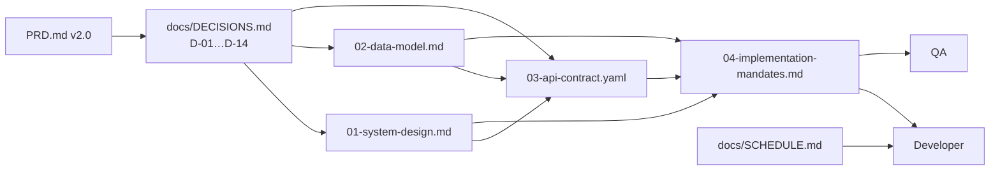

# Architecture of Record

**Package ID:** `ARCH`
**Status:** APPROVED
**Date:** 2026-09-27
**Code baseline at approval:** pushed `091d0f8` plus the uncommitted P0.5 platform-hardening
working tree of 2026-09-27 (`packages/config`, `eslint.config.mjs`, `Dockerfile.web`/`Dockerfile.worker`,
`compose.staging.yml`, `infra/scripts/`, `deploy-staging.yml`, `dependabot.yml`, expanded CI). That
work must be committed and pushed before implementation begins.
**Owner:** Chief Software Architect
**Audience:** Developer (implementation), QA (verification), Architect (change control)

This directory is the architecture of record for Mark-US. It is written against the pushed P0
scaffold, not against an idealised system, and every statement in it is falsifiable by a test or a
query.

## Documents

| Doc | Contents | Primary audience |
| --- | --- | --- |
| [01-system-design.md](./01-system-design.md) | Module boundaries, deployable topology, stack matrix, auth and session model, request and job flows, state management, reliability, security, CI/CD, NFRs, open decisions | Developer, Architect |
| [02-data-model.md](./02-data-model.md) | Entity model with ER diagrams, index and query plan, P0.3 migration backlog, partitioning and retention, migration protocol | Developer, DBA/SRE |
| [03-api-contract.yaml](./03-api-contract.yaml) | OpenAPI 3.1 contract: 65 paths, 83 operations, 106 schemas, with per-operation maturity, phase, permission and audit annotations | Developer, QA |
| [04-implementation-mandates.md](./04-implementation-mandates.md) | 76 numbered mandates with owners, dependencies, automated verification and halt conditions, plus the definition of done and the halt-item log | Developer, QA, Architect |

## How the documents fit together

**Precedence.** `PRD.md` states product intent. `docs/DECISIONS.md` holds the binding decisions.
This package is the technical expression of those decisions. `docs/SCHEDULE.md` sequences the
work. Where this package and an earlier document disagree, this package wins for design and the
earlier document must be corrected in the same change.

**Change control.** Any deviation from these documents requires an ADR numbered D-15 or later in
`docs/DECISIONS.md`, plus an update to the affected document here, before code merges. Mandate
identifiers in `04` are permanent; a superseded mandate keeps its number and gains a
`Status: SUPERSEDED by` line.

## The ten rules that constrain every implementation

1. Filing is attended. A human attorney submits to USPTO inside a `filing-session` ceremony; the
   system never files automatically (D-01, 37 CFR 2.193).
2. USPTO MFA seeds are never stored, requested or logged. Envelope encryption with KMS-wrapped keys,
   audited on every read (D-01).
3. Authorization is deny-by-default and enforced three times: edge, API middleware, SQL scope.
4. No client PII reaches a third-party LLM; only minimised mark and business context, and only with
   recorded consent (D-04, PIPL).
5. No probability, similarity or recommendation is ever shown without its model version and
   3-locale disclaimer, and never as legal advice (D-03).
6. Money is a decimal string plus currency, everywhere, including the database (D-05).
7. Documents are versioned and append-only; only a human-approved version satisfies a filing
   precondition.
8. Every state transition and every privileged read is audited in the same transaction as the change.
9. Third-party analytics is prohibited; the first-party beacon is the only telemetry (D-07).
10. Typecheck, tests, build and contract lint are green on `main` before merge (D-14).

## Contract maturity

`03-api-contract.yaml` annotates every operation with `x-contract-status`:

| Value | Meaning | Developer obligation |
| --- | --- | --- |
| `final` | Frozen | Implement exactly; deviations are defects |
| `provisional` | Shape agreed, may still change before the owning phase starts | Implement, but expect additive changes |
| `PENDING-Pn` | Deferred to phase `n` | Do not implement; publish a contract revision first |

The current contract is `final` for P0–P4 core flows, `provisional` for the P3 conversation and P7
reporting surfaces, and `PENDING-P5`, `PENDING-P6`, `PENDING-P7` or `PENDING-P8` where the shape
depends on data or a decision that does not exist yet.

## Open decisions that block work

Recorded in `01-system-design.md` §15 and `04-implementation-mandates.md` §18. The engineering
positions are:

| ID | Decision | Posture while open |
| --- | --- | --- |
| OPEN-01 | Mainland Alipay / WeChat Pay merchant accounts | Routes exist in the contract, disabled by feature flag, `503` when off |
| OPEN-02 | USPTO bulk-data licensing and attended-filing legal review | Corpus ingest and filing ceremony cannot be signed off |
| OPEN-03 | Probability cohort and label horizon | Field labelled `PENDING-P6`, no calibration claim |
| OPEN-04 | Attorney roster, bar numbers, capacity | Filing preconditions cannot be validated end to end |
| OPEN-05 | Hong Kong hosting and ICP path | Staging topology stays provisional |
| OPEN-06 | Node 20 or 22: the whole working tree pins 20, but the CI runner is deprecated and `01` recommends 22 LTS (mandate `M1.6`) | Pin before the first production deploy |
| OPEN-07 | Refund approval threshold | Configuration value, required before P4 sign-off |
| OPEN-08 | Model minimum sample size for release | Release pipeline stays blocked for P6 |
| OPEN-09 | PIPL retention basis per PII column | Erasure cannot be declared complete |

## Handoff

Implementation starts with the P0.3 migration backlog in `02` §5 and mandate `M1.1`. Every mandate
carries its own verification, so no phase review depends on a conversation.

[ARCHITECT APPROVED: READY FOR DEVELOPER IMPLEMENTATION]
